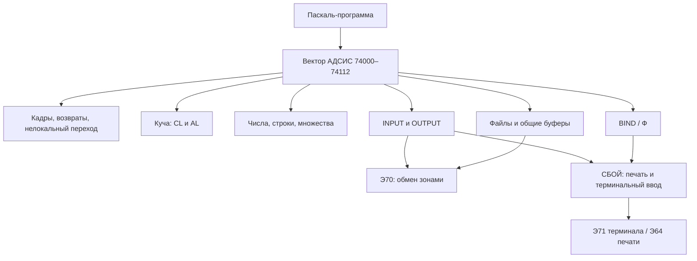

# АДСИС: административная система Паскаля

АДСИС занимает **зону 01006** томов 2148/2248 и исполняется в
**074000–075777**, лист 36. На реконструированном томе 2068 это зона
**006**, без изменений машинного кода. Размер — **1024 слова, 6144 байта**.
Образы обоих исходных томов полностью совпадают, SHA-256:

```text
5d63a973e26ac613f324658f0ad3241ebe3a05db843db96afd447ea2826ea087
```

АДСИС — библиотека времени исполнения Паскаля-автокода. Она обслуживает стек Паскаля, стандартные потоки,
файлы, выделение памяти, представление чисел и строк, печать и ошибки.
Загрузчики Паскаль-программ держат её по фиксированным адресам; статический
компоновщик для обращения к этим процедурам не требуется.

Все адреса, номера устройств/зон, смещения и коды ниже восьмеричные.
Длины в словах/байтах и числа в математических формулах — десятичные,
если не сказано иначе. `L/R` обозначают половины машинного слова.

## Листинг и проверка

```sh
make adsis
make checkadsis DISPAK=dispak
```

Первая команда без эмулятора создаёт **build/АДСИС.lst**,
**build/АДСИС.dump** и **build/АДСИС-map.json** по разметке [syms/АДСИС.sym](../syms/АДСИС.sym).
Вторая запускает [tests/adsis.py](../tests/adsis.py): компиляцию и исполнение
Паскаль-программ на временных копиях томов, с отдельным HOME.
Входы, вывод и полные трассы сохраняются в **build/adsis-probes/**.
Системные тома и образ АДСИС не исправляются; контрольные суммы исходных
томов проверяются после завершения теста.

В sym-файле явно отделены код, таблицы, константы, рабочие поля и
остаточный хвост. Тип **257** останавливает анализ исполнения на данных.
Трассы компиляции и девяти проверочных программ охватили **682 различных
адресов слов** АДСИС; ни один из них не попал в область, размеченную как данные.
В это покрытие входит также работа самого компилятора, использующего
ту же АДСИС. Проверяются адреса исполненных команд с обоими разделителями
`:` и `;`; строки записей в память в покрытие не входят.

[tests/adsis-layout.py](../tests/adsis-layout.py) проверяет разметку всех
1024 слов, отсутствие конфликтов кода и данных, цели 311 распознанных
прямых переходов внутри страницы и пересечение трасс с областями данных.
Итог — **849 слов кода и 175 слов данных**, **682 исполненных слов кода**.
Подробный отчёт тестов — `build/adsis-probes/coverage.json`: разбиение по
подсистемам, адреса непокрытого кода, символы и отдельные трассы.
При обычном `make adsis` отчёт содержит только статическую карту.

## Исходник БЕМШ и точная сборка

[adsis.be](../adsis.be) восстанавливает всю страницу **74000–75777**:
команды, таблицы, рабочие ячейки и остаточный хвост. Короткие метки
соответствуют входам и процедурам из разбора; комментарии сохраняют
адреса и развёрнутые имена из sym-файла. Вещественные константы записаны
точными шестнадцатеричными словами, с десятичными приближениями
в комментариях. Нулевые рабочие поля объявлены через `ПАМ`.
Исходные ошибки форматирования сохранены как часть образа.

```sh
make checkadsisasm DISPAK=dispak
```

[tools/build-adsis.py](../tools/build-adsis.py) формирует задание БЕМШ
06/78 с частным HOME и выходным томом 1234. Транслятор берётся с тома
2048, компоновщик — через `ЧТКОМП420070` с тома 2099. После сборки
выполняются **`НАЗ 074000`** и **`ЗОНГП 430001 000001`**.
Назначение 074000 сохраняет адреса обращений к АДСИС и размещает её
первое слово в начале выходной зоны. При назначении 000001 образ
сдвинулся бы на слово и получил другие адреса команд.

Проверено:

- **ЧИСЛО ОШИБОК=0000**, максимальная серьёзность 0;
- ЗОНГП: **АМИН=74000, АМАКС=75777, АСВОБ=76000**;
- **1024/1024 слова и 6144/6144 байта** совпадают с зонами
  **2148:01006** и **2248:01006**, считанными через besmtool;
- контрольные суммы всех четырёх исходных томов после сборки совпадают.

Последнее нулевое слово **75777** явно инициализировано через `КОНД`,
чтобы оно входило в диапазон АМАКС. Левые вызовы сохранены как `ПВЛ`;
явные правые половины сохраняют исходные слова заполнения.

Задание, листинг БЕМШ/компоновщика, образ фактического вывода ЗОНГП
и отчёт сравнения сохраняются в **build/adsis-asm/**:
`adsis.b6`, `adsis.lst`, `adsis.img`, `comparison.json`.
SHA-256 собранной зоны совпадает с указанной в начале разбора.

Разметка **75313** выделяет рабочее слово форматного вывода из кодового
диапазона. **75424** — исполняемый диспетчер выдачи очередной цифры:
он относится к коду, а вещественные константы заканчиваются на 75423.
Тип 257 означает DATA | NOEXEC в дизассемблере и не изменяет образ машины.

## Архитектура одной страницы

Паскаль-программа содержит собственные прологи процедур, локальные данные
и часть коротких helpers. Общие операции вызываются по фиксированным
адресам АДСИС. Начальный вектор перенаправляет вызовы в тела той же страницы;
ряд операций компилятор вызывает сразу по адресу тела.



В центре состояния находятся два разных механизма:

- **Кадры программы:** М1 задаёт главный кадр, М13 — текущий, М17 —
  вычислительный стек. Прологи генерирует компилятор; АДСИС снимает кадры
  и помогает восстанавливать окружение при нелокальных переходах.
- **Общие рабочие слова библиотеки:** указатели INPUT/OUTPUT, границы кучи,
  списки файловых буферов и зон, адреса возврата и состояние форматирования
  хранятся по фиксированным адресам страницы. Поэтому библиотечные вызовы
  используют общее изменяемое состояние.

Стандартные INPUT/OUTPUT передают байты, упакованные по шесть в слово.
Произвольный FILE работает с записями своего типа, собственным описателем
и локальным буфером. За локальными буферами стоит общий зонный буфер и
пул внутренних зон. Терминальный BIND сначала обращается к СБОЙ, затем
подключает полученный текст к обычному механизму INPUT.

Печать строки стандартного OUTPUT проходит через PR и СБОЙ. Вывод в
типизированный файл проходит через PF. Э70 передаёт целые зоны по 1024
слова, а продвижение символа или записи выполняется в памяти между обменами.

## Загрузка и связь с компилятором

БАВТ загружает АДСИС при запуске машинного образа с сигнатурой Паскаля
в слове 00004. Общий путь **66335–66340** строит дескриптор
**0010360000400006**, читает лист 36 и продолжает запуск выбранной
программы. ПУСК для ДЖИН делает аналогичное чтение в **01337**.
Программы ДАЙ библиотеку не требуют.

В начале автокода Паскаль-компилятор выдаёт эквивалентности. Их можно
сверить с процедурой `header` в исходнике
`pasauto-re/pasauto.pas`, в частности:

```text
ИА=74000,УРЕГ=ИА(3),Z0=УРЕГ(2),ПБИ15,ЕF,Н,Т,Е,
ОС=Е(5),SL=ОС(2),Z64,РR=SL(10),МОD=РR(3),VR,СПТ,СПЛ,
RF=VR(5),ЧМ1,ГТ=RF(5),RС=ГТ(6),СР=RС(4),АВ,ОВ,RWF,
СТХТ=ОВ(5),WS,WС,WА,WВ,WI,WR,WL,ОWS,ОWС,ОWА,ОWВ,ОWI,ОWR,ОWL,
ИК=ОWL(2),СЧ,ЗЧ
```

Пропущенный адрес означает следующее слово, а `(10)` — прибавление
**010**. Поэтому, например, PR = 74031, MOD = 74034, GF = 74041,
OWI = 74104. Имена смешивают латинские и кириллические буквы;
в таблицах ниже они записаны удобными для чтения латинскими аналогами,
когда это не меняет смысл. В sym-файле сохранены имена из заголовка.

**ИА = 74000** — имя базы, а не вход процедуры. Само слово 74000 содержит
**`0xFFFFFFFFFFFF`**. Другие важные константы внутри вектора:

| Адрес | Имя | Значение и использование |
|---|---|---|
| 74002 | — | Два шаблона адресного модификатора |
| 74011 | Т | Рабочее/резервное слово, исходно 0 |
| 74014 | — | Шаблон для описателей обмена, используется сгенерированным кодом БД |
| 74022 | Z64 | `0xD00000000000`, добавление порядка к машинному целому |
| 74043 | ЧМ1 | `0x810000000000`, вещественное −1 |

## Вектор входов

Начальные слова содержат переходы к телам процедур, иногда с подготовкой
регистра или РАУ. Вектор **74000–74112** нельзя целиком считать таблицей
переходов: в нём находятся и приведённые выше данные.

### Управление программой, память и файлы

| Вход | Имя | Реализация / действие |
|---|---|---|
| 74001 | — | 74113, завершение с дописыванием выходного потока |
| 74003 | УРЕГ | `пб (М10)`, возврат к прологу программы |
| 74004 | — | 74114, подготовить завершение через печать накопленного вывода |
| 74005 | Z0 | Сохранить A в 74205, затем 74117, записать остаток вывода |
| 74006 | ПБИ15 | `пб (М15)` |
| 74007 | EF | Вызов процедуры, чей адрес упакован в слове кадра |
| 74010 | Н | Ошибка АДСИС 012 |
| 74012 | Е | 74170, снять текущий кадр и вернуться |
| 74013 | — | 74544, освободить цепочку внутренних зон файла |
| 74015 | — | 75714, восстановить регистры кадров |
| 74016 | — | Ошибка с кодом, уже находящимся в М15 |
| 74017 | ОС | Снять два слова стека и перейти по адресу продолжения |
| 74021 | SL | Сдвинуть A на байт и начать последовательность меток |
| 74023 | — | 74173, PCK, собрать шесть байтов в ALFA |
| 74024 | — | 74202, INTEGER → REAL |
| 74025 | — | 74206, NEW / AL |
| 74026 | — | 74222, GET стандартного INPUT / GI |
| 74027 | — | 74251, RESET стандартного INPUT / RI |
| 74030 | — | 74257, PUT стандартного OUTPUT / PO |
| 74031 | PR | 74307, вывести накопленный текст через СБОЙ |
| 74032 | — | 74313, REWRITE стандартного OUTPUT / RO |
| 74033 | — | 74337, UNPCK / UN |
| 74034 | MOD | 74350, целочисленный остаток |
| 74035 | VR | 74610, создать/переоткрыть файловый дескриптор |
| 74036 | СПТ | 74676, настроить пул внутренних зон |
| 74037 | СПЛ | 74666, настроить пул буферов |
| 74040 | — | 74715, PUT произвольного файла / PF |
| 74041 | — | 74760, GET произвольного файла / GF |
| 74042 | RF | 74362, RESET произвольного файла |
| 74044 | — | 75104, ГОСТ → ИТМ одного символа / ГА |
| 74045 | — | 75115, ГОСТ → ИТМ слова ALFA / ЯГА |
| 74046 | — | 75075, инициализировать область NEW / CL |
| 74047 | ГТ | 75351, вывести заданное число символов из памяти |
| 74050 | — | 75361, MAPIA, число → ALFA |
| 74051 | — | 75363, MAPAI, ALFA → число |
| 74052 | — | 75165, TNL, следующая метка |
| 74053 | — | 75365, ГГ, вывод ALFA без ведущих нулевых байтов |
| 74054 | — | Ошибка 6, общий вход N |
| 74055 | RC | 75400, выход с разбором стека и файлов кадров |
| 74056 | — | 74145, вход D: сохранить A и проверить сигнатуру отладчика |
| 74057 | — | 74141, TRUNC / TR |
| 74060 | — | 74136, преобразовать целочисленный результат умножения / ЦУ |
| 74061 | СР | 75654, общий путь сравнений REAL с допуском |
| 74062 | АВ | 75670, вариант сравнения REAL |
| 74063 | ОВ | 75664, другой вариант сравнения REAL |
| 74064 | RWF | 74554, REWRITE произвольного файла |
| 74065 | — | 75241, ошибка границы индекса / OV |
| 74066 | — | 75675, привязать терминальный ввод / Ф |
| 74067 | — | Исходный `Э62 0`, специальный/резервный слот |

Прямые адреса AL, GI, RI, PO, RO, MI, UN, PF, GF, CL и остальных
также объявлены компилятором: вызов через короткий вектор не обязателен.
Наличие имени в заголовке не означает, что каждый путь используется
каждой программой.

### Форматный вывод

Семь пар входов печатают соответственно в файл и в стандартный OUTPUT:

| Тип | В файл | В OUTPUT | Основное тело |
|---|---|---|---|
| Строка из памяти | 74071 WS | 74100 OWS | 75324 / 75317 |
| CHAR | 74072 WC | 74101 OWC | 75270 |
| ALFA | 74073 WA | 74102 OWA | 75275 |
| BOOLEAN | 74074 WB | 74103 OWB | 75314 → WA/OWA |
| INTEGER | 74075 WI | 74104 OWI | 75442 |
| REAL | 74076 WR | 74105 OWR | 75474 |
| Конец строки | 74077 WL | 74106 OWL | 75303 / 75301 |

Общий вывод байта **75304** выбирает OUTPUT или файл по флагу в
**75313**; **75302** вызывает PO, **75303** записывает текущий символ
и передаёт управление в PF. Входы WI/OWI и WR/OWR задают флаг через М11.
В других парах назначаются разные адреса продолжения.

Последние служебные входы:

| Адрес | Имя | Действие |
|---|---|---|
| 74107 | — | Второй исходный `Э62 0`, резерв |
| 74110 | ИК | Добавить одиночный элемент множества, тело 75730 |
| 74111 | СЧ | Добавить элемент с уже подготовленным смещением, 75744 |
| 74112 | ЗЧ | Добавить диапазон элементов, 75737 |

## Соглашения вызова и стек

АДСИС не имеет единого соглашения «все аргументы в одном блоке»:
конкретный вход задаёт собственные регистры и стековые операнды.
Основные роли:

| Регистр | Роль |
|---|---|
| М1 | База главного кадра: в том числе INPUT в `7(М1)`, OUTPUT в `10(М1)` |
| М13 | Текущий кадр процедуры |
| М17 | Первый свободный элемент вычислительного стека |
| М16 | Возврат большинства непосредственных библиотечных вызовов |
| М14 | Возврат ГТ/ГГ; также адрес переменной для NEW |
| М15 | Файловый дескриптор, адрес строки или рабочий адрес — по входу |
| М12 | Размер объекта/массива, счётчик символов или специальный возврат |
| М11 | В частности флаг «файл/OUTPUT» у числовых процедур печати |

Многие процедуры используют общие слова **74205, 74356–74357**.
Библиотека не реентерабельна: сохранность этих полей обеспечивается
последовательностью вызовов, а не отдельной копией для каждого кадра.

**74003** сам ничего не инициализирует. В машинной программе типовой
пролог — `пв 74003(М10)`; полученное М10 = 00010 используется для
перехода обратно в программу. Затем она превращает М10 в свою базу
и выполняет подготовленный компилятором пролог. Для программ с
перемещением применяется соответствующее адресное смещение.

Кадр содержит ссылку на предыдущий кадр в слове 0 и адрес продолжения
в младших разрядах слова 1. В старшей части слова 1 может находиться
адрес процедуры завершения кадра. **74166–74167** выделяют его сдвигом
на 15 разрядов и вызывают через М14. **74170–74172** делают:

```text
М17 := М13
М13 := память[М13]
переход память[М17 + 1]
```

Простое описание применимо к этому входу; прологи, возвраты на внешний
лексический уровень и функции используют дополнительные сгенерированные
последовательности. Регистры уровней восстанавливает **RSR 75714–75727**
по цепочкам кадров. **RC 75400–75415** идёт по кадрам к целевому, вызывает
их процедуры завершения и освобождает файловые ресурсы. В главном кадре
есть также цепочка в `4(М1)`.

Разбор аварийного Pascal-стека выполняет соседний [СБОЙ](sboy.md),
который вызывает, например, 74031, 74047, 74102 и 74104. Это отдельный
механизм от сообщений `ОШ.АДСИС`.

## Завершение программы и связь с ПАСК

**74001 → 74113 → 74305** добавляет перевод строки/конец текста через
общий вывод. **74004 → 74114** дополнительно переустанавливает INPUT
и очищает цепочку `4(М1)`. **74005** принимает в A слово для включения
в остаток выходного потока.

**74117–74135** дописывают последнюю зону OUTPUT. Если текущий
дескриптор уже ушёл с начальной зоны, код перечитывает последний блок
и начальный блок, чтобы внести завершающее слово в нужное место.
Рабочее слово и указатель выходного буфера используют **74205** и М5.

Далее **74124** проверяет **содержимое слова 74003**:

- Ноль: перейти непосредственно в **76002**, выход ПУЛЬТ.
- Ненулевое: прочитать **лист 33 с барабана 17:037** по дескриптору
  **74152 = 0010330000170037**, установить М6 = 66000, М10 = 56000,
  перейти через `6(М6)` в сохранённый ПАСК.

Проверка завершившейся программы использовала второй путь и получила
`ВСЕ СДЕЛАНО.`. Само слово 74003 при этом оставалось `пб (М10)`.
Инициализация/завершение зависит от окружения ПАСК и состояния барабанов;
чтение одной зоны АДСИС в память ещё не создаёт готовый Pascal-процесс.

## Стандартные INPUT и OUTPUT

Стандартные потоки обслуживаются отдельно от произвольных файлов.
Это упаковка **шести байтов на слово** с подкачкой зон через Э70.

### INPUT: GI и RI

**74222–74250** сдвигают рабочее слово **74217** на один байт,
помещают выделенный символ в **`7(М1)`** и сдвигают маску **74220**.
Когда слово исчерпано, увеличивается указатель **75225** и берётся
следующее слово буфера. После границы буфера проверяется счётчик
**74221**, предел **75212**, выполняется Э70 через **74357**.

**74251** начинает поток заново: читает начальную зону по **75211**,
обнуляет счётчик зон и передаёт управление общему получению символа.
Исходный код конца INPUT в **75206** — **0172**.

### OUTPUT: PO, RO и PR

**74257–74301** берут **`10(М1)`**, упаковывают очередной байт в
**74256**, затем по заполнении слова сохраняют его по **75224**.
После заполнения буфера выполняется Э70 с дескриптором **75223**,
увеличивается зона и счётчик **75235**. Достижение предела **75204**
даёт ошибку **2**.

**RO 74313** начинает OUTPUT заново: возвращает указатель к **75205**,
восстанавливает дескриптор **75203**, маску и предел буфера, обнуляет
счётчик зон. **PR 74307** заканчивает накопленный текст и вызывает
**76005**, печать СБОЙ, с началом буфера в М15, затем вновь выполняет RO.
Таким образом, WRITELN стандартного OUTPUT в ПУЛЬТ может немедленно
попадать на терминал, а большой поток автокода — на барабан.

Основные поля потоков:

| Адрес | Назначение |
|---|---|
| 74215 / 74216 | Начальные маски байтов INPUT / OUTPUT: 020 и 040 |
| 74217, 74220 | Текущее слово и маска позиции INPUT |
| 74221 | Счётчик входных зон |
| 74254–74256 | Маска, граница и упаковка OUTPUT |
| 75203–75205 | Начальный дескриптор, предельное число зон, начало OUTPUT |
| 75206–75207 | Код конца и начало INPUT |
| 75210–75212 | Граница буфера, дескриптор и предел зон INPUT |
| 75223–75225 | Текущие дескриптор OUTPUT и указатели обоих потоков |
| 75235 | Число записанных зон OUTPUT |

В исходном образе, например, **75203** — запись листа 35 на барабан
27:0, **75211** — чтение листа 34 с 27:0. ПАСК меняет эти поля под
текущий этап трансляции: считать их постоянным внешним размещением
пользовательского файла нельзя.

### Терминальный ввод Ф

**75675–75713** — другая услуга. При ненулевом М15 она сначала копирует
небольшой блок параметров в область 070000, заполненную кодами **0172**.
Затем задаёт **76407 = 077000** и вызывает ввод СБОЙ **76415**.
Для специального режима использует **76423**. После ввода передаёт
управление общей подкачке INPUT, переустановив её адрес продолжения.

[terminal.pas](../tests/adsis/terminal.pas) вызывает BIND с приглашением
`ВВОД>`, получает терминальную строку `А` и печатает `ОТВЕТ А`.
Трасса проходит через 75675, 75707 → 76415, 75711 и общую подкачку 74242.

Компилятор вызывает этот вход для **BIND**. Это не универсальный
парсер READ: обычные READ/READLN в разобранной версии компилятора
явно отвергаются (`standProc`, ветвь 22/23). Посимвольные GET и доступ
к `F@` поддерживаются и проверены.

## Произвольные файлы

Для `_FILE OF T` компилятор размещает отдельный дескриптор,
область текущей записи и локальный буфер. Обычный дескриптор занимает
**22 слова**, для упакованного файла добавляются рабочие слова;
встроенный TEXT имеет размер **30 слов** до локального буфера.
Параметр компилятора задаёт размер буфера кратно **256 словам**.

**VR 74610–74665** получает в М15 адрес дескриптора, в М12 размер элемента,
в М11 параметры упаковки, в М14 размер буфера в единицах по 256 слов. Подготавливаются смещения,
маски и состояния. В зависимости от состояния вызова тот же код идёт
через **74567** к переоткрытию/освобождению; повторный вызов VR не всегда
означает создание нового объекта.

Для файлов, заданных внешними параметрами программы, компилятор также
заполняет **`3(М15)` и `4(М15)`**: начало и протяжённость внешней области.
Нулевая протяжённость включает внутренние зоны из пула АДСИС.
Внутренние файлы автоматически не превращаются в элементы архива ПУЛЬТ.

| Смещение от дескриптора | Использование по процедурам |
|---|---|
| 0 | Состояние упаковки; ноль выбирает неупакованный путь |
| 1 | Текущая позиция записи, изменяется GET/PUT |
| 2 | Признак конца файла, который проверяет EOF |
| 3, 4 | Начало цепочки/внешней области и заданная протяжённость |
| 5 | Текущее звено цепочки либо позиция во внешней области |
| 6 | Счётчик слов при переносе части буфера |
| 7 | Связь с выделенным общим буфером |
| 010–012 | Счётчики чтения/записи и сохранённая граница |
| 013–015 | Адреса/границы рабочей записи и локального буфера |
| 016 | Флаг состояния записи; используется при дописывании и сбросе |
| 017, 020 | Сохранённые позиции при переключении чтения/записи |
| 021 | Размер элемента в словах |
| 022–025 | Границы и сдвиги упакованной записи |

Это карта использования полей данного образа. Для полной спецификации
внешнего файлового формата нужно учитывать и заголовок, который генерирует
компилятор для конкретного типа.

### RESET, REWRITE, GET, PUT

- **RF 74362–74403** дописывает незавершённую запись, сохраняет границу,
  возвращает позицию в начало и подготавливает чтение первого элемента.
- **RWF 74554–74566** освобождает связанные буферы, обнуляет счётчики
  чтения/записи, возвращает файл в режим записи.
- **PF 74715–74756** проверяет состояние, увеличивает счётчик записей,
  переносит элемент в локальный/общий буфер и обрабатывает его заполнение.
- **GF 74760–75044** продвигает позицию чтения, получает очередной блок,
  копирует запись в рабочую область и устанавливает EOF по сохранённой границе.

В неупакованном случае переносятся полные слова; упакованные элементы
используют **75045–75071** с масками/сдвигами из дескриптора.
Текстовый файл выдаёт байты через ту же файловую систему, а не через
обычный OUTPUT: поэтому `WRITELN(T,...)` и `WRITELN(...)` идут разными ветками.

### Общие буферы и внутренние зоны

**СПЛ 74666** строит список общих буферов; **СПТ 74676** — список доступных
внутренних зон. **75220/75221** держат свободные/занятые буферы,
**75222** — свободные звенья зон.

В исходном образе 75216 = 75217 = 066000, то есть для СПЛ задан один
общий лист. В цикле **74670–74675** М15 не увеличивается: при разных
начальной и конечной границах код сам не продвигается к следующему
буферу. Настройка многолистового пула этой процедурой не проверена;
описание одноэлементного списка не следует считать доказательством
работы произвольного диапазона.

**74445–74501** находят или выделяют буфер. В заголовке буфера держатся
связи списка и ссылка на обслуживаемый файл. При вытеснении записывается
изменённый блок. **74525–74543** отвязывают буфер, **74544–74553** возвращают
внутренние зоны в свободную цепочку. Внешняя область с заданной длиной
не освобождается как внутренний файл.

**74404–74444** формируют обмены для текущего блока; фактический Э70
находится в **74441**. В проверке файла из **1030 INTEGER** выполнены
записи и чтения зон **11:037, 11:036** через лист **33**. Это два блока
по 1024 слова, а не 1030 самостоятельных дисковых обменов. Проверены
все числа, их сумма **530965** и EOF после последнего элемента.

Проверка [files.pas](../tests/adsis/files.pas) чередует работу двух файлов
с трёхсловными записями: по 400 записей, 1200 слов на каждый файл. После
RESET сверяются все поля и EOF; общая сумма полей равна **562600**.
Трасса содержит чтение и запись **11:034–037** через лист 33. Третий файл
`PACKED FILE OF 0..7` сохраняет 1030 трёхбитных элементов, сумма — **3605**;
исполняются обе ветви упаковки 75045 и распаковки 75060. Его 65 слов данных
помещаются в локальном буфере. Эта проверка подтверждает работу нескольких
описателей, переключение общего буфера, перенос многословных записей и
упакованные GET/PUT.


## Куча и NEW/DISPOSE

**CL 75075–75103** получает размер области в М12 и использует текущий
М17 как начало её управляющей пары. Адрес пары сохраняется в **75231**.
В пару записываются адрес первого свободного слова и отрицательная
верхняя граница; сам стек сдвигается за отведённую область.

Если при входе S = М17, N = М12, последовательность 75075–75102 задаёт:

```text
75231 := S
память[S] := S + 2          первый свободный адрес
память[S + 1] := -(S + N)   отрицательная верхняя граница
М17 := S + N
```

Все адресные операции выполняются в 15 разрядах. В N входят два слова
управления; при K1 область занимает 1024 слова, из них 1022 доступны NEW.

**AL 74206–74213** получает М12 = число слов, М14 = адрес переменной-указателя:

1. В М15 взять адрес управляющей пары из 75231.
2. Старый первый свободный адрес записать по М14.
3. Увеличить его на М12 и сохранить в первом слове пары.
4. Сложить новый адрес с отрицательной верхней границей.
5. Если место ещё допустимо, вернуться; иначе записать по М14
   **NIL = 064000** из **75201** и вернуться.

Это выделение продвижением границы. В данной процедуре нет поиска
подходящего освобождённого блока и нет отката уже увеличенной границы
при переполнении. Для проверки границы используется режим циклического
сложения и знак результата, а не обычный тест «равно нулю».

**DISPOSE** не имеет собственного тела в этой зоне. Компилятор при
необходимости выдаёт helper **DS**, который ведёт цепочки через
**СОС = 75236** и **СОЯ = 75237**. SETUP/ROLLUP также частично реализуются
сгенерированным кодом. Наличие этих средств не доказывает, что AL
автоматически переиспользует освобождённую память.

Проверка создала два связанных двухсловных узла, проверила сумму их
полей **42** и выполнила DISPOSE.

Отдельная [heap-error.pas](../tests/adsis/heap-error.pas) задаёт K1
(1024 слова), сохраняет SETUP-границу и запрашивает 1025 слов. NEW
возвращает NIL; следующий NEW одного слова также возвращает NIL, поскольку
первый запрос уже увеличил границу. После ROLLUP(SAVED) однословный NEW
снова успешен; запись и чтение дают 42. Этим подтверждены отсутствие
отката AL и восстановление границы через ROLLUP. Повторное использование
блоков после DISPOSE этим опытом не проверяется.

## Арифметика и множества

**R 74202–74203** превращает машинное INTEGER в REAL: добавляет биты
порядка через Z64 и нормализует сложением с нулём. **TR 74141–74142**
выполняет обратное преобразование с подавлением округления/нормализации
и маской целого **74204 = 0x01FFFFFFFFFF**. **ЦУ 74136–74140** восстанавливает
целый результат машинного умножения из младших разрядов и знака.

**MOD 74034** сначала выполняет R, затем через **74350–74355** получает
целую часть частного, умножает её на делитель и вычитает из делимого.
Другой вход **74344–74347** получает целую часть частного. Компилятор
для DIV на степень двойки может вместо них выдать непосредственный сдвиг.
Проверены переменные **37 DIV 5 = 7**, **37 MOD 5 = 2**,
INTEGER → REAL и **TRUNC(9.25) = 9**, **ROUND(9.25) = 9**.
Отрицательные аргументы и граничные переполнения отдельно не проверялись.

### Сравнения REAL с допуском: CP, AB, OB

**75650–75653** выбирают из двух операндов значение с большим модулем.
**CP 75654–75663** умножает его на константу **75673**, приблизительно
10⁻⁶, вычисляет разность и сравнивает модули. Алгоритмически, с учётом
округления промежуточных операций БЭСМ-6:

```text
threshold := abs(epsilon * maxByMagnitude(x, y))
delta := y - x
CP := 0, если abs(delta) <= threshold; иначе 1
```

При входе x находится в последнем занятом слове стека, y — в A.
CP снимает слово с x, возвращается через М14 и устанавливает РАУ = 7. Значение delta остаётся в памяти на три слова выше восстановленного
М17. **OB 75664** при различимых операндах берёт delta, **AB 75670** меняет
его знак; для близких операндов обе ветви берут вещественную единицу из
**74214**. Эти обёртки устанавливают РАУ = 023 и возвращаются через М12.
Это регистровое соглашение учитывает код последующего условного перехода.

[real-compare.pas](../tests/adsis/real-compare.pas) включает `(*=R+*)`:
1000000 и 1000000.5 считаются равными, оба строгих сравнения ложны.
Для 1000000 и 1000002 равенство ложно, `<` истинно. Проверены также
противоположные знаки и сравнение двух нулей. После `(*=R-*)` числа
1000000 и 1000000.5 различаются. Выполнение всех четырёх тел
75650, 75654, 75664, 75670 подтверждено трассой. Точки точно на пороге
округления этим набором не проверяются.

Одиночный элемент множества строится в **75730–75735** сдвигом старшего
бита. Индекс проверяется на шесть разрядов: при выходе из 0…63 получается
нулевой вклад. Языковое множество ограничено **0…47**, поэтому остальные
индексы не следует считать разрешённым расширением типа.
**75737–75746** добавляют диапазон; обратные границы дают ошибку **040**.
Проверено построение `[I,J..7]` при I = 3, J = 5, CARD = 4, MINEL = 3.
CARD/MINEL сами компилируются в машинные операции счёта/поиска разрядов;
отдельных процедур АДСИС для них нет.

SQRT, SIN, COS, ARCTAN, ARCSIN, LN и EXP компилятор выдаёт через
**Э50**, а не через тела АДСИС. ROUND частично реализован в helper АС,
который добавляет 0.5 и использует TR.

## Тексты, кодировки и метки

### PCK и UNPCK

**PCK 74173–74201** собирает шесть однословных символов по М15
в одно ALFA, последовательно сдвигая на 8 разрядов. **UNPCK 74337–74343**
разбирает A на шесть байтов и записывает их по М15. В обоих случаях
используется возврат через М16; М14 служит счётчиком разборки/упаковки.
В проверке `ABCXYZ` после UNPCK/PCK восстановилось без изменений.

### ГОСТ → ИТМ

**ГА 75104–75114** выбирает байт из таблицы **75126–75154**:
младшие два разряда кода задают позицию в слове, старшие — слово таблицы.
Для кодов **0134 и выше** возвращается пробел **017**.
Таблица содержит полный байт ИТМ, включая старший разряд; механически
отбрасывать его нельзя.

**ЯГА 75115–75125** разворачивает ALFA на стеке, применяет ГА к каждому
символу и собирает слово снова. Это не обратное преобразование.
Проверенный `MAPГА('A',CH)` дал **152 в десятичной записи**,
то есть **0230 = 0x98**. MAPЯГА вызвана также для слова `ABCXYZ`.
Текст остальных сообщений АДСИС хранится в ГОСТ.

### MAPIA и MAPAI

**IA 75361–75362** сдвигает число и разносит младшие **15 двоичных
разрядов** маской **75160 = 0x000707070707** в пять восьмеричных цифр.
Шестой, старший байт остаётся нулём, что в ГОСТ означает символ `0`.
**AI 75363–75364** делает обратную выборку пяти цифр; это не десятичный
парсер и не проверка корректности произвольной строки.

Проверено `12345B → '012345' → 12345B`.

### TNL и ГГ

**TNL 75165–75174** ведёт последовательность машинных имён в рабочих
словах **75155, 75232–75233**. При переносе меняет маску и добавляет
следующий разряд. Это генерация меток компилятора, а не обращение
к системному каталогу.

**ГГ 75365–75376** пропускает ведущие нулевые байты ALFA и выдаёт
остаток через PO. **ГТ 75351–75360** выдаёт заданное количество байтов
из массива, используя отрицательные счётчики М11/М12 и М15.
Терминаторы ГГ/ГТ определяются их соглашением вызова, а не обязательным
нулевым словом после массива.

## Числовое форматирование

**INTEGER 75442–75472** сохраняет значение, знак и ширину, превращает
модуль в последовательность десятичных цифр через деление на 10,
добавляет знак и пробелы и восстанавливает стек. Цифры и заполнение
передаются общему выводу 75304, поэтому один алгоритм используется
как для файла, так и для стандартного OUTPUT.

### Проверка печати INTEGER

[integer-print.pas](../tests/adsis/integer-print.pas) проверяет **277
значений** при ширинах **0, 5, 16 и стандартной 10**, через оба входа:
**74104 OWI** для OUTPUT и **74075 WI** для TEXT. Записанный TEXT
читается посимвольно. Python сравнивает **2216 преобразований** со
`str(n).rjust(width)`, включая пробелы и знак. Выборка содержит ноль,
числа обоих знаков около степеней десяти до 10¹², степени двойки
и соседние значения, максимум **2⁴⁰−1** и минимум **−2⁴⁰**.
Слишком узкое поле расширяется до длины числа; цифры не обрезаются.

Обнаружена ошибка на **−1099511627776 = −2⁴⁰**: оба входа при всех
четырёх ширинах печатают **−1099511627773**. Остальные **2208**
преобразований выборки совпали с ожидаемым результатом, в том числе
**1099511627775** и **−1099511627775**.

Трасса минимального INTEGER:

```text
00052  сч 3(М2)          = 0020000000000000  (−2⁴⁰)
75447  знак 74043        → 0050000000000000
75427  или 74022         → 6450000000000000
75434  вчоб -2(М17)      → 0040000000000003  (первая цифра 3)
```

В **75447** отрицание минимальной мантиссы увеличивает машинный порядок:
положительный модуль 2⁴⁰ не помещается в положительную целую мантиссу.
В **75427** алгоритм добавляет порядок через OR с Z64 и далее выделяет
цифры, предполагая обычное представление модуля INTEGER. Полученное
представление нарушает это предположение; первая выделенная цифра
оказывается 3 вместо 6. Входное значение по трассе правильное.
Соседние крайние значения формируются без промежуточного переполнения:
при P = 2³⁹ используются `P-1+P`, `-P-P`, `-P-P+1`.

Исходный образ АДСИС сохранён. Тест явно проверяет найденную ошибку
как известный дефект и требует точного совпадения остальных строк.
Отчёт с ожидаемыми и фактическими строками:
`build/adsis-probes/integer-print.json`. Повторение:

```sh
TMPDIR="$PWD/build/tmp" python3 tests/adsis.py \
  --dispak dispak --case integer-print
```

### Печать REAL и BOOLEAN

**REAL 75474–75620** нормализует величину по десятичному порядку,
вычисляет цифры и округление, выдаёт мантиссу и показатель.
В таблице **75621–75641** находятся 10, 100, 10000, 100000000,
дальнейшие степени, приближение log10(2) и поправки для округления.
В **75642–75647** лежат параметры и коды знаков/разделителей.

Параметры поля формирует компилятор на стеке; INTEGER получает ширину,
REAL — ширину и точность. Указание точности не доказывает фиксированного
формата: проверенное **`Y:10:3`**, Y = 9.25, напечатало **`9.250Е+00`**.
Буква `Е` здесь — фактический символ ГОСТ из АДСИС.

BOOLEAN печатается через тексты **75416–75417**:
`  TRUE` и ` FALSE`. Проверены INTEGER, REAL, BOOLEAN, CHAR, ALFA,
строки, стандартный OUTPUT и вывод в TEXT.

### Алгоритм печати REAL (75474–75647)

Общий формат — `[пробелы][знак]a.dddЕ±kk`: одна цифра до точки,
D цифр после неё и две цифры порядка. Положительное число получает
пробел на месте знака. Цифры ГОСТ имеют коды 0–9, поэтому целое
значение первой цифры можно сразу передать символьному выводу.

#### Входы, стек и назначение вывода

Компилятор для `write(X:W:D)` кладёт в стек W, затем D, загружает X
в A и вызывает один из входов:

| Адрес | Назначение | Действие |
|---|---|---|
| 74105 OWR | OUTPUT | М11 = 0; переход в 75474 |
| 74076 WR | TEXT | М11 = 1; переход в 75474 |

В **75474–75475** сохраняются X и адрес возврата М16. Флаг М11
записывается в общую ячейку **75313**. После этого, при S = М17:

| Ячейка | Содержимое |
|---|---|
| S−4 | W, затем рабочая разность для заполнения, затем десятичный порядок k |
| S−3 | D, в конце заменяется на 2 для печати порядка |
| S−2 | X, затем модуль, масштабированная мантисса и её дробный остаток |
| S−1 | адрес возврата |
| S и выше | временные слова, в том числе результат построения степени в S+1 |

**75601–75603** направляют отдельные символы в **75302** (OUTPUT)
или **75304** (TEXT). Для целых полей **75576–75600** восстанавливают
тот же флаг в М11 и вызывают **75442**, общий преобразователь INTEGER.

#### Параметры, пробелы и знак: 75476–75523

D ограничивается снизу единицей и сверху **10**. При ширине W от 0 до 7
включительно вместо неё берётся 8: **75504–75506** проверяют нулевой
результат логического сдвига W на три бита. Отрицательная ширина этой
проверкой не заменяется; ранее проверенные формулы длины относятся к
неотрицательным ширинам.

Из W вычитается D. Цикл **75510–75514** печатает пробел, пока
`W−D >= 7`, уменьшая рабочую разность после каждой выдачи. Получается
`max(0, W−D−6)` ведущих пробелов. Число 7 учитывает знак мантиссы,
первую цифру, точку, Е, знак порядка и две цифры порядка.
Условие с равенством объясняет установленный лишний пробел.

**75515–75523** печатают пробел для X ≥ 0 или минус для X < 0.
Для отрицательного X команда **75521** меняет его знак. Дальнейшие
операции выполняются над модулем; знак уже выдан и больше не хранится
в мантиссе. Здесь ячейка заполнения **75202** ещё содержит пробел ГОСТ.

#### Оценка десятичного порядка: 75524–75527

Из старших семи битов X извлекается машинный порядок E, затем
вычитается смещение 64. Если `X = m × 2^e`, где `e = E−64` и
нормализованный положительный m находится в [0.5, 1), вычисляется:

```text
k := floor(e × C)
C = 0.3010300000000825…   — слово 75627
```

C — приближение log10(2). Вычисление использует **R 74202** для
преобразования целого e в REAL и **TR 74141** для получения целого k.
Для отрицательного дробного результата этот машинный путь даёт
округление вниз: например, e = −1 даёт k = −1.
Логарифм самого X не вычисляется. Его мантисса будет учтена последующей
проверкой масштабированного значения.

#### Построение 10^|k|: 75604–75620

Процедура принимает целую степень в A, берёт её модуль n и создаёт
произведение по двоичному разложению n. Биты n просматриваются от младшего
к старшему. Для каждого установленного бита i аккумулятор произведения
умножается на элемент таблицы `10^(2^i)`:

| Адрес | Значение |
|---|---:|
| 75621 | 10 |
| 75622 | 100 |
| 75623 | 10000 |
| 75624 | 100000000 |
| 75625 | 10¹⁶ |

Например, для n = 10 используются 10² × 10⁸. При n = 0 результат — 1.
Произведение возвращается в **1(М17)**. Эта же процедура затем строит
10^D для дробной части.

Для n > 18 ветвь **75616–75620** возвращает табличное **10¹⁸** из
75626 и заменяет k в **−4(М17)** на **+18**. Знак исходной степени
при этом теряется; влияние этой ветви на малые числа описано ниже.

#### Масштабирование и поправка порядка: 75530–75540

При k ≥ 0 модуль X делится на 10^k; при k < 0 умножается на 10^|k|.
Получается десятичная мантисса y. Если y < 1, выполняется одна поправка:

```text
y := y × 10;
k := k − 1;
```

Цикла здесь нет. Для обычного нормализованного числа оценка по двоичному
порядку оставляет только такую поправку. Проверка нуля отдельной ветвью
отсутствует.

#### Округление: 75541–75547

Команда **75541** модифицирует адрес таблицы значением D и выбирает
слово **75627+D**. В мантиссу прибавляется приближение `0.5 × 10^(−D)`.
Таблица содержит слегка завышенные двоичные значения поправок:

| D | Адрес | Значение, округлённое для показа |
|---:|---|---:|
| 1 | 75630 | 0.05000000000001137 |
| 2 | 75631 | 0.005000000000002558 |
| 3 | 75632 | 0.0005000000000006111 |
| 4 | 75633 | 0.00005000000000010552 |
| 5 | 75634 | 0.000005000000000011939 |
| 6 | 75635 | 5.000000000013674×10⁻⁷ |
| 7 | 75636 | 5.000000000013674×10⁻⁸ |
| 8 | 75637 | 5.000000000010964×10⁻⁹ |
| 9 | 75640 | 5.000000000010964×10⁻¹⁰ |
| 10 | 75641 | 5.000000000010964×10⁻¹¹ |

Далее, если y ≥ 10, выполняются `y := y / 10; k := k + 1`.
Это перенос при округлении: 9.9996 при D = 3 превращается в
1.00001… с увеличенным порядком и затем печатается как `1.000Е+01`.
Прибавка задаёт округление модуля вверх на точной половине, в том числе
для отрицательного исходного числа. Все арифметические операции здесь
машинные; таблица и промежуточные результаты имеют конечную точность.
Проверка границ степеней ниже показывает случаи нарушения этого правила
при последующем выделении цифр.

#### Первая цифра и дробная часть: 75550–75562

Через TR получается `a := floor(y)`. Его вещественное представление
вычитается из y, оставляя `f := y−a`. В **75554** a печатается одним
символом ГОСТ, в **75556** выдаётся точка.

Затем в **75555** ячейка **75202** устанавливается в **0** — код
цифры «0» в ГОСТ. Вычисляются 10^D и целое
`b := floor(f × 10^D)`. Поле b печатается общим INTEGER-преобразователем
с шириной D. Его обычное заполнение слева теперь выдаёт нули.
Поэтому b = 25 при D = 4 превращается в `0025`.

Таким образом, после первой цифры дробная часть выдаётся как **одно
целое поле**. Предварительно прибавленная поправка обеспечивает
округление; при извлечении a и b выполняется отсечение.

#### Показатель и возврат: 75563–75603

D в стеке заменяется на 2. Печатаются **Е**, знак k и модуль k через
тот же INTEGER-преобразователь с шириной 2. Пока **75202 = 0**, однозначный
порядок получает ведущий ноль: `Е+00`, `Е−01` и т.д.
В **75572** ячейке 75202 возвращается пробел ГОСТ, код **0x0F**.
Стек освобождается от параметров и сохранённых слов, выполняется возврат
по сохранённому адресу. WRITELN отдельно вызывает WL/OWL для конца строки.

Общие ячейки **75202** и **75313** используются на всём протяжении
форматирования. Вывод дроби и порядка разделяет преобразователь INTEGER,
а символы и поля идут в один выбранный канал. Отдельной ветви фиксированной
точки в этом алгоритме нет.

#### Сводный псевдокод

Здесь `intdown` обозначает описанное машинное преобразование с округлением
вниз, `emitint` — общий INTEGER-преобразователь, а операции над REAL
выполняются с точностью БЭСМ-6. Ветка ограничения степени сохранена:

```text
D := min(10, max(1, D));
if W in 0..7 then W := 8;
emit(' ', max(0, W − D − 6));
emit(if X < 0 then '−' else ' ');
x := abs(X);
k := intdown((exponentbits(x) − 64) × C);
if abs(k) > 18 then begin
    p := table10to18;
    k := 18;
end else p := power10(abs(k));
if k < 0 then y := x × p else y := x / p;
if y < 1 then begin y := y × 10; k := k − 1 end;
y := y + roundtable[D];
if y >= 10 then begin y := y / 10; k := k + 1 end;
a := intdown(y);
f := y − real(a);
emitGostDigit(a); emit('.');
fill := '0';
emitint(intdown(f × power10(D)), D);
emit('Е'); emit(if k < 0 then '−' else '+');
emitint(abs(k), 2);
fill := ' ';
```

Для проверенного `writeln(1/3:50:40)` D сначала ограничивается до 10.
Входное слово **3752525252525252**, e = −1 и k = −1. Умножение на 10
даёт y ≈ 3.3333333333; после поправки округления выделяются a = 3
и b = 3333333333. Результат: **35 пробелов** и `3.3333333333Е-01`,
всего 51 символ. Для D от 10 до 25 получены одинаковые строки.

### Проверка печати REAL

[real-print.pas](../tests/adsis/real-print.pas) проверяет **38 значений**
через **74105 OWR** и **74076 WR**. Для каждого выполняются восемь
преобразований `X:W:D`, одно `X` и одно `X:20`: всего **760**.
Вывод в TEXT читается посимвольно и точно совпадает с OUTPUT.
Проверены ширины 0, 1, 10, 20, 26 и точности −1, 0, 1, 3, 6, 10, 11.
Точность ограничивается диапазоном **1–10 цифр после точки**;
формат всегда экспоненциальный. По умолчанию W = 14, D = 4;
при указании только ширины D остаётся 4. Неотрицательная ширина меньше 8 заменяется на 8.

[adsis-real-output.py](../tests/adsis-real-output.py) извлекает 48-битное
значение непосредственно из A на входе **75474**, проверяет его неизменность
при всех форматах и обоих каналах. Независимый эталон использует Decimal
с точностью 100: знаковая 41-битная мантисса умножается на
2^(машинный порядок − 104), затем выполняется десятичное округление
до заданного числа цифр. Полные ожидаемые и фактические поля записываются
в `build/adsis-probes/real-print.json`.

Выявлены следующие особенности и ошибки.

| Проверка | Результат |
|---|---|
| Обычные значения, оба знака, до ±6.9175×10¹⁸ | Цифры и показатель совпали с эталоном |
| Точные половины, например 1.25 при D=1 | Округление модуля вверх: `1.3Е+00` |
| Переход через степень десяти, 9.9996 при D=3 | `1.000Е+01` |
| 2⁻⁶⁰ ≈ 8.6736×10⁻¹⁹ | При D=3: `8.674Е-19` |
| ±2⁻⁶¹, ±10⁻¹⁹, 2⁻⁶⁴, 2⁻⁶⁵ | Теряют ненулевое значение: `0.000Е+17` или `-0.000Е+17` при D=3 |
| Ноль | `0.000Е+17` при D=3; численно это ноль, показатель необычен |
| 9.25 с `:10:3` | `  9.250Е+00`: 11 символов, на один больше заданной ширины |

**Потеря малых чисел.** В **75524–75527** оценивается десятичный порядок.
Для входного слова **0056603622476666** (около 10⁻¹⁹) получается −19.
Процедура **75604** ограничивает модуль степени значением 18. В ветви
**75616–75620** она возвращает 10¹⁸ и записывает **+18** вместо исходного
отрицательного порядка. Поэтому **75531–75532** выбирают деление на 10¹⁸;
результат выходит ниже машинного диапазона и становится нулём.
Следующая коррекция **75537–75540** уменьшает показатель до +17.
Для нуля та же ветвь объясняет показатель +17.
В выборке потеряны шесть ненулевых значений при всех десяти форматах
и обоих каналах: **120 преобразований**.

**Лишний пробел.** Цикл **75510–75514** выдаёт пробел и при равенстве
W−D=7; проверка выхода происходит после лишней итерации. В проверенных
форматах длина поля равна **max(max(W,8)+1, D+7)**, где D уже ограничено
диапазоном 1–10. Это даёт **684 поля** с лишним символом по сравнению с
шириной max(W,8,D+7). Для узкого `:0:10` поле расширяется до необходимых
17 символов без дополнительного пробела.

Остальные **620 преобразований** дали ожидаемые цифры и показатель.
Ещё **20** преобразований нуля отличаются только показателем +17.
Ошибок округления в этой выборке не обнаружено. В частности, литерал
9.9995 хранится как **9.999499999990803…** и при D=3 правильно даёт
`9.999Е+00`; сравнение с исходной десятичной записью скрыло бы причину.

Тест сохраняет исходный образ и явно учитывает установленные дефекты,
требуя совпадения остальных результатов. Проверка не охватывает каждое
машинное значение и все возможные ширины. Повторение:

```sh
TMPDIR="$PWD/build/tmp" python3 tests/adsis.py \
  --dispak dispak --case real-print
```

### Верхняя граница модуля REAL

[adsis-real-limits.py](../tests/adsis-real-limits.py) использует шаблон
[real-limit.pas](../tests/adsis/real-limit.pas). Машинное слово загружается
командой CODE непосредственно в A и присваивается через `X := ;`.
Это позволяет проверить печать предельного значения без переполнения
при его предварительном вычислении. Трасса подтверждает точное слово
на входе **75474** при каждом вызове. Используется исходная АДСИС;
контрольные суммы системных томов после опыта совпадают.

При максимальном поле порядка E = 127 вещественное значение равно
`m × 2^63`, где положительная мантисса меньше 1, а отрицательная может
равняться −1. Шаг мантиссы 2⁻⁴⁰ соответствует здесь шагу значения **2²³**.
Поэтому границы асимметричны:

| Значение | Машинное слово, восьмеричное | Точное десятичное значение |
|---|---|---:|
| Максимальное положительное | 7757777777777777 | 9223372036846387200 = 2⁶³−2²³ |
| Его отрицательное | 7760000000000001 | −9223372036846387200 |
| Минимальное отрицательное, наибольший модуль | 7760000000000000 | −9223372036854775808 = −2⁶³ |

Восемь значений `±(2⁶³−δ×2²³)` при δ = **1, 2, 16, 1024**
проверены с D от 1 до 10 в OUTPUT и TEXT: **160 преобразований**.
Цифры и показатели совпадают с Decimal-эталоном точного машинного числа.
Поля совпадают с учётом ранее установленного лишнего пробела.
Для максимального положительного получено:

| D | Число без ведущих пробелов |
|---:|---|
| 1 | 9.2Е+18 |
| 3 | 9.223Е+18 |
| 6 | 9.223372Е+18 |
| 10 | 9.2233720368Е+18 |

Для самого отрицательного **−2⁶³** оба канала аварийно завершают
вывод с **АВОСТ 000017**. Точная причина по трассе:

```text
75474  A = 7760000000000000       входное −2⁶³
75521  знак 74043                 смена знака при множителе −1
       АВОСТ 000017              переполнение порядка
```

На **75521** требуется получить положительный модуль **+2⁶³**.
Такое число уже не представимо: нормализованной положительной мантиссе
потребуется поле порядка 128. Сбой возникает при получении модуля,
до масштабирования и округления. Две отдельные сессии подтверждают
его через OWR и через WR. Число **−2⁶³+2²³** успешно печатается.

В тесте проверяются восемь успешных сессий и две ожидаемые аварии,
включая адрес 75521 и код 000017. Отчёт с точными числами, словами
и результатами: `build/adsis-real-limits/report.json`. Повторение:

```sh
TMPDIR="$PWD/build/tmp" make checkadsislimits \
  DISPAK=dispak
```

### Границы степеней десяти и двойки

[adsis-real-boundaries.py](../tests/adsis-real-boundaries.py) проверяет:

- 10^k при **k от −19 до 18**: ближайшее положительное машинное число
  и его непосредственных соседей по величине;
- 2^k при **k от −65 до 62**: само число и соседей; у 2⁻⁶⁵ нижний сосед
  вне диапазона нормализованных положительных мантисс исключён;
- отрицательные числа тех же модулей;
- точность **D от 1 до 10**, оба канала OUTPUT и TEXT, ширину 26.

Для положительных чисел сосед выбирается с учётом смены машинного
порядка: перед минимальной мантиссой очередного порядка идёт максимальная
мантисса предыдущего. При 10^k, не представимом точно, центральное слово
получается округлением к ближайшему с разрешением половины вверх.
Одинаковые слова из разных наборов исполняются один раз, с сохранением
всех соответствующих границ в отчёте.
Отрицательное слово строится из той же точной величины; при возможности
мантисса нормализуется. Для −2⁻⁶⁵ используется ненормализованное слово
**0030000000000000**, сохраняющее точное значение при минимальном порядке.

Итого **988 различных слов и 19 760 преобразований**. Они задаются
непосредственно через CODE в шаблоне
[real-boundaries.pas](../tests/adsis/real-boundaries.pas). Источники чисел
и эталон формируются с Decimal, точность 100. Весь вывод TEXT совпал
с OUTPUT, аварий не было. **18 984** преобразования дали ожидаемые цифры
и показатели; **776** отличаются от десятичного округления half-up:

| Причина | Слов с ошибкой | Преобразований |
|---|---:|---:|
| Обнуление малых ненулевых чисел | 36 | 720 |
| Ошибка последней цифры при отдельных D | 28 | 56 |

Граница обнуления в выборке проходит точно по **2⁻⁶⁰**:
само число и следующий больший модуль печатаются правильно,
предыдущий меньший модуль становится нулём. Результат симметричен по знаку.
Около десятичных степеней ошибается только набор у **10⁻¹⁹**, целиком
попавший в область обнуления. У всех остальных проверенных десятичных
границ цифры и показатель верны, включая перенос округления через степень.

Ошибки последней цифры найдены у следующих **положительных** слов.
«+1 шаг» означает непосредственного машинного соседа выше точной степени.
Для отрицательных слов ошибочная строка отличается только знаком;
каждый случай повторился в OUTPUT и TEXT.

| Величина | D | Эталон | АДСИС |
|---|---:|---|---|
| 2⁻⁵² | 10 | 2.2204460493Е-16 | 2.2204460492Е-16 |
| 2⁻⁴⁰ + 1 шаг | 10 | 9.0949470177Е-13 | 9.0949470178Е-13 |
| 2⁻³⁴ + 1 шаг | 10 | 5.8207660914Е-11 | 5.8207660913Е-11 |
| 2⁻³⁰ | 10 | 9.3132257462Е-10 | 9.3132257461Е-10 |
| 2⁻¹⁶ | 10 | 1.5258789063Е-05 | 1.5258789062Е-05 |
| 2⁻¹⁵ | 9 | 3.051757813Е-05 | 3.051757812Е-05 |
| 2⁻¹⁴ | 8 | 6.10351563Е-05 | 6.10351562Е-05 |
| 2⁻¹² | 7 | 2.4414063Е-04 | 2.4414062Е-04 |
| 2⁻¹¹ | 6 | 4.882813Е-04 | 4.882812Е-04 |
| 2⁻¹⁰ | 5 | 9.76563Е-04 | 9.76562Е-04 |
| 2⁻⁹ | 5 | 1.95313Е-03 | 1.95312Е-03 |
| 2⁻⁸ | 4 | 3.9063Е-03 | 3.9062Е-03 |
| 2⁻⁴ | 1 | 6.3Е-02 | 6.2Е-02 |
| 2⁵³ | 10 | 9.0071992547Е+15 | 9.0071992548Е+15 |

#### Трасса потери цифры у 2⁻⁴

Вход **3650000000000000** точно равен 0.0625. При D=1 нормализация
даёт ровно 6.25. Табличная поправка немного больше 0.05, однако результат
её сложения представляется машинным числом **6.299999999995634425…**.
Дальнейшая трасса:

| Адрес | Значение после операции |
|---|---|
| 75536 | y = 6.25 |
| 75542, сохранение 75543 | y = 6.299999999995634425… |
| 75552 | f = 0.299999999995634425… |
| 75560, вход TR в 75561 | f × 10 = 2.999999999956344254… |
| 75561–75562 | целое 2, выдано `6.2Е-02` |

Слегка завышенная поправка теряется при сложении с большей мантиссой.
При выделении дробной части код отсекает результат чуть ниже целой границы.
Даже точная половина 6.25 поэтому не обеспечивает округления вверх.

У **2⁻⁵²** при D=10 после поправки получается
2.220446049297606805…; произведение дроби на 10¹⁰ равно
**2204460492.97265625**, отсекается до 2204460492 вместо 2204460493.

У **2⁵³** ошибка в противоположную сторону. После деления на 10¹⁶
получается 0.900719925473822513…; дополнительное умножение на 10 даёт
9.007199254745501093… вместо точной десятичной мантиссы 9.007199254740992.
После округляющей прибавки выходит 9.007199254803708754…;
дробное поле становится 71992548 вместо 71992547. Здесь погрешности
масштабирования и округляющего сложения изменяют последнюю цифру вверх.

Тест явно проверяет эти 14 пар слово/точность, их отрицательные зеркала
и обнуление ниже 2⁻⁶⁰; любое другое расхождение считается новым сбоем.
Все поля имеют 27 символов, включая известный лишний пробел при W=26.
Системные образы не меняются. Полный отчёт с точными словами, величинами,
привязкой к границам и каждой строкой:
`build/adsis-real-boundaries/report.json`.

```sh
TMPDIR="$PWD/build/tmp" make checkadsisboundaries \
  DISPAK=dispak

# Подробные трассы 2⁻⁴, 2⁻⁵² и 2⁵³, отдельный каталог результатов:
TMPDIR="$PWD/build/tmp" python3 tests/adsis-real-boundaries.py \
  --dispak dispak \
  --case-id 595 --case-id 307 --case-id 931
```

### Более точное приближение log10(2)

В отдельной временной копии 2068 заменено только слово **75627**:

| Вариант | Машинное слово, восьмеричное | Значение |
|---|---|---|
| Исходное | 3751504046525073 | 0.3010300000000825… |
| Новое | 3751504046502374 | 0.3010299956640665… |

Новое слово получено округлением запрошенного **0.301029995664**
к ближайшей положительной мантиссе БЭСМ-6. Изменены только 48 бит
этого слова в частной копии тома; тег сохранён. Системные образы
и извлечённая исходная АДСИС остались прежними. Отдельная подробная
трасса подтверждает чтение нового слова командой **75526**.

Повторены **19 760 преобразований** граничной выборки. Все поля,
включая пробелы, совпали с исходным вариантом. Сохранились **720**
обнулений малых величин и **56** ошибок последней цифры.

Причина отсутствия изменений: константа используется для получения
целого `k = floor(e × C)`, после чего её дробная точность уже не участвует
в обработке мантиссы. Для каждого возможного e = E−64 из диапазона
**−64…63** обе константы дают одинаковое k. При e ≠ 0 ближайшее расстояние
нового произведения до целого больше **0.01029995664**, тогда как изменение
самого произведения при замене константы меньше 0.00000028.
Погрешность машинного умножения существенно меньше этого запаса.
При e = 0 результат в обоих случаях точно нулевой.

Таким образом, уточнение log10(2) сохраняет выбранную степень десяти,
путь масштабирования, поправку округления и все последующие операции.
Установленные ошибки находятся в ограничении степени, арифметике
масштабирования и выделении дробного поля.

Результаты, исходные и новые слова, все 128 оценок порядка и сравнение
каждой строки: `build/adsis-real-boundaries/log10-0.301029995664/report.json`.
Повторение после обычной граничной проверки:

```sh
TMPDIR="$PWD/build/tmp" python3 tests/adsis-real-boundaries.py \
  --dispak dispak \
  --log10-constant 0.301029995664
```

## Ошибки

### Общий обработчик MI

**74323–74326** берут код из М15, сдвигают на байт, добавляют к слову
**74322** и печатают через **76005** сообщение из **74321–74322**:

```text
ОШ.АДСИС=03
```

Затем выполняется **пб 76002**. Это выход из пользовательского вычисления
в ПУЛЬТ, а не возврат по библиотечному адресу М16.
Число фактически выдаётся байтом ГОСТ, поэтому таблицу кодов следует
читать по установленному М15, не как форматирование произвольного INTEGER.

| Код | Где устанавливается | Условие по коду |
|---|---|---|
| 0 | 74662 | Выход из файловой ветки с ошибочным состоянием |
| 1 | 74236 | Достигнута граница доступных зон стандартного INPUT |
| 2 | 74275 | Переполнен стандартный OUTPUT |
| 3 | 74757 | GET после конца файла |
| 4 | 74714 | PUT при запрещающем состоянии файла |
| 6 | 74151 / 74054 | Общий вход N; семантика зависит от сгенерированного вызова |
| 7 | 74421 | Нет свободного звена внутреннего файла |
| 010 | 74420 | Исчерпана заданная внешняя область файла |
| 012 | 74010 | Общий вход Н |
| 040 | 75736 | Обратные границы диапазона множества |

Таблица перечисляет явные установщики кода в АДСИС; не все они
воспроизведены динамически. Проверка файла с одной записью сделала
RESET и два GET: второй GET напечатал **ОШ.АДСИС=03**, недостижимый
контрольный WRITELN после него не выполнялся, ПУЛЬТ принял `КОНЕЦ`.

### Граница индекса OV

**75241–75244** получают номер исходной строки в М14,
преобразуют его через IA и печатают сообщение **75245–75247**
`ГР ИНД.СТР= …`, затем уходят через СБОЙ. Сгенерированный компилятором
код предварительно сравнивает индекс с нижней/верхней границами;
сам OV не имеет параметров описателя массива и не делает этого сравнения.

При `(*=T+*)`, массиве `[1..2]` и переменном индексе 3 проверка получила
**`ГР ИНД.СТР= 00005`**. Команда после аварийного обращения не исполнилась.

### Сообщение QU

`СТАТИС` без аргумента загружает АДСИС, но **не исполняет её**.
БАВТ **66364** обнаруживает отсутствие следующей лексемы, переходит
в **67217**, выбирает текст `QU` по адресу **67221** и печатает его
через **76005**. Это проверено отдельной полной трассой.
Поэтому `QU` не является кодом ошибки АДСИС и не доказывает
неисправности её файлового ввода.

## Карта страницы и покрытие

Карта отражает разметку всей зоны. Код и данные посчитаны в машинных
словах; наличие команды в карте не означает, что все её ветви проверены.
Последняя колонка показывает разные адреса слов из трасс девяти программ
и их компиляции. Проценты не отражают покрытие обеих половин и всех условий.

| Подсистема | Диапазон | Код | Данные | Исполнено |
|---|---|---:|---:|---:|
| Вектор входов | 74000–74112 | 69 | 6 | 33 |
| Завершение | 74113–74135 | 19 | 0 | 10 |
| Преобразование INTEGER/REAL | 74136–74142 | 5 | 0 | 5 |
| Отладчик и константы | 74143–74165 | 5 | 14 | 0 |
| Кадры и PCK | 74166–74203 | 14 | 0 | 14 |
| NEW и рабочие поля | 74204–74221 | 6 | 8 | 6 |
| Стандартные потоки | 74222–74336 | 61 | 16 | 47 |
| UNPCK и MOD | 74337–74361 | 15 | 4 | 15 |
| Произвольные файлы | 74362–75074 | 327 | 4 | 266 |
| Инициализация кучи | 75075–75103 | 7 | 0 | 7 |
| ГОСТ → ИТМ | 75104–75154 | 18 | 23 | 17 |
| Имена меток | 75155–75174 | 11 | 5 | 11 |
| Неиспользуемый фрагмент | 75175–75200 | 0 | 4 | 0 |
| Общее состояние | 75201–75240 | 0 | 32 | 0 |
| Индекс и контекст INPUT | 75241–75257 | 11 | 4 | 4 |
| Текстовый вывод | 75260–75377 | 78 | 2 | 67 |
| Раскрутка стека | 75400–75423 | 14 | 6 | 10 |
| INTEGER → текст | 75424–75473 | 39 | 1 | 39 |
| REAL → текст | 75474–75647 | 85 | 23 | 85 |
| Сравнения REAL | 75650–75674 | 19 | 2 | 18 |
| Терминальный INPUT | 75675–75713 | 15 | 0 | 15 |
| Восстановление регистров | 75714–75727 | 12 | 0 | 0 |
| Множества | 75730–75747 | 15 | 1 | 13 |
| Закрытие файлов | 75750–75753 | 4 | 0 | 0 |
| Остаточный хвост | 75754–75777 | 0 | 20 | 0 |

`coverage.json` перечисляет также каждый непокрытый адрес кода и вклад
отдельной трассы. В существующих пробах не исполнялись отладочный вход D,
RSR и закрытие файлов через 75750; их описание основано на командах.

## Данные и границы достоверности

Крупнейшие блоки данных: **75126–75161**, **75200–75240**,
**75621–75647**. **74205, 74356–74357, 75313** — общие рабочие ячейки,
а не константы. Часть полей настраивает ПАСК; отсутствие начальной
настройки нельзя компенсировать только копированием зоны 006.

**75175–75177** — не связанный с установленными входами фрагмент
команд. **75754–75777** — остаточный хвост; в нём есть совпадающие
с хвостами других образов инструкции и последовательность загрузки,
но входящих переходов из разобранных процедур к нему не найдено.
Они сохранены в дампе и размечены как данные, без выдуманного API.

Динамически проверены [runtime.pas](../tests/adsis/runtime.pas),
[bounds.pas](../tests/adsis/bounds.pas), [file-error.pas](../tests/adsis/file-error.pas),
[heap-error.pas](../tests/adsis/heap-error.pas), [files.pas](../tests/adsis/files.pas),
[terminal.pas](../tests/adsis/terminal.pas),
[real-compare.pas](../tests/adsis/real-compare.pas),
[integer-print.pas](../tests/adsis/integer-print.pas) и
[real-print.pas](../tests/adsis/real-print.pas).
Полный контракт внешних файлов и особых ветвей форматирования требует
дополнительных опытов. Пробы внутренних файлов охватывают INTEGER, TEXT,
трёхсловные записи и трёхбитные упакованные элементы. Проверка NEW,
DISPOSE и ROLLUP не устанавливает наличие сборщика мусора.
Загрузчик сегментов ЗАГР по 077040 к этой зоне не относится;
его совместимость описана в [разборе сегментации](pascal-segments.md).
