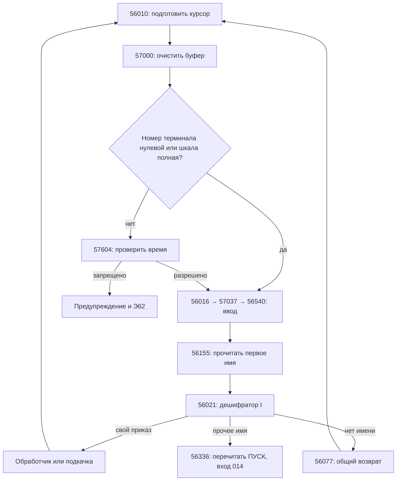

# НАБЛ: цикл приказов, разбор текста и терминальный обмен

НАБЛ — «начальный блок» ПУЛЬТ, содержащий дешифратор приказов I.
Он занимает одну зону **01041** системного тома. При загрузке ПУСК
сначала читает её в **02000–03777**, настраивает рабочие поля и сохраняет
на барабане **27:037**. Рабочее размещение — **056000–057777**, лист 27;
вход в цикл — **056010**, база **М10 = 056000**.

Образы 2148 и 2248 побайтно одинаковы: 1024 слова, 6144 байта;
SHA-256 шестибайтного образа:
`832a19d261841dd1fb7c16735db6ae51c9caf5811d2e1d54c21b35415dbf3302`.
На 2068 тот же образ находится в зоне **041**.
Первоначальная загрузка и настройка описаны в [разборе ПУСК](pusk.md).

Все адреса, номера устройств, зон, коды символов и значения без специальных
оговорок далее восьмеричные. Размеры буферов, количество символов,
номера уровней и время — десятичные. Адреса ниже приведены для рабочего
размещения, а не для промежуточного листа 1. Имена символов аналитические.

## Воспроизводимый листинг

```sh
make nabl
```

Без запуска эмулятора создаются:

- `build/НАБЛ.lst` — символический листинг с базой 056000;
- `build/НАБЛ.dump` — все слова исходной зоны 01041, с обоими полусловами,
  восьмеричным и шестнадцатеричным представлением.

Разметка — [syms/НАБЛ.sym](../syms/НАБЛ.sym). Используется
`~/git/leobru/dispak-tools/disbesm6`; вход 056010 и дополнительные входы
заданы явно, поэтому листинг включает ветви, не посещённые последним сеансом.
Тип **257** — десятичное `W_DATA | W_NOEXEC`: через данные и ещё не
атрибутированные фрагменты анализ исполнения не продолжается.
Тип **520** — `W_SETBASE | 010`: подсказка М10 = 056000.
Число 6144 в заголовке `Code` дизассемблера означает байты, а не слова.

Полный dump нужен и для слов двойного назначения, и для оставшихся
фрагментов: внешний вид пары команд сам по себе не доказывает, что
эта пара исполняется в текущем НАБЛ.

## Размещение и интерфейсы

| Адрес | Назначение |
|---|---|
| 56000–56007 | Заголовок образа; 56006 содержит `пб (М3)` |
| 56010–56026 | Начало цикла и поиск приказа в таблице |
| 56027–56076 | Таблица приказов, с включённым в неё кодом 56053–56064 |
| 56077–56107 | Общий путь для нераспознанного начала строки и ошибок разбора |
| 56110–56127 | Следующий байт входного текста |
| 56155–56212 | Чтение лексемы в три слова |
| 56226–56255 | Классификация символов и пропуск пробелов |
| 56264–56275 | Чтение восьмеричного числа |
| 56300–56350 | Подкачка обработчиков и переходы на них |
| 56400, 56414, 56416 | Входы вывода |
| 56415, 56417 | Входы ввода |
| 56424–56533 | Форматирование вывода, порции и отмена |
| 56537–56625 | Приём текста и расшифровка экранной записи символов |
| 56626–56721 | Вспомогательные процедуры форматтера |
| 57000–57007 | Продолжение начала цикла: очистка буфера и выбор проверки времени |
| 57037 | Действующий трамплин `пб 0540(М10)` в процедуру ввода |
| 57604–57630 | Проверка разрешённого времени |
| 57632–57635 | Проверка статуса терминального вывода |
| 57700–57715 | Чтение имени с переводом к архивному представлению |
| 57722–57745 | Приказ СИС |
| 57750–57752 | Дополнительный вход чтения числа |

| Поле | Содержание |
|---|---|
| 56146 | Текущий код символа в младшем байте |
| 56147–56152 | Сохраняемый курсор чтения: слово, маска, остаток символов и слов |
| 56222–56224 | Лексема, до 18 символов |
| 56263 | Прочитанное восьмеричное число |
| 56320 | Сохранённый статус приёма |
| 56351 | Исходный номер листа отладчика, 024 |
| 56352–56354 | Вещественные константы: 3000, 60, 30 (десятичные) |
| 56355–56366 | Дескрипторы подкачки |
| 56401–56404 | Четыре управляющих слова Э71, настраиваемые ПУСК |
| 56405 | Указатель исходного текста для вывода |
| 56406 | Адрес буфера ввода; обычно 057640 |
| 56407 | Лимит ввода; обычно −020 слов, то есть 16 слов |
| 56410 | Ограничитель обхода текста при выводе, первоначально 070000 |
| 56411–56412 | Отрицательный счётчик слов и конечный указатель принятого текста |
| 56413 | Ответ о наличии терминала |
| 56420 | Включение печатной копии обмена, протокола |
| 56421–56422 | Исходный и текущий счётчик порций; первоначально 14 строк |
| 56655–56673 | Общее сохранение регистров процедур ввода/вывода |
| 56710–56711 | Байт форматтера и собираемая строка замены |
| 56722, 56727 | Префиксы экранной записи на выходе и входе |
| 56734–56755 | Таблица экранной записи символов |
| 56761… | Буфер выдачи; его первые слова также используются как временные поля при разборе ввода |
| 57600 | Шкала разрешённого времени, устанавливается при загрузке |
| 57640–57657 | Обычный буфер приказа, 16 слов |
| 57757 | Признак конца строки для режима ЛИС |
| 57760 | Номер терминала; участвует в выборе проверки времени |
| 57761–57764 | Сохранённые терминальные управляющие слова |
| 57765 | Чтение НАБЛ с барабана в лист 27 |
| 57766 | Код конца строки 0175 |
| 57767 | Текущая система, первоначально КОД |
| 57770–57777 | Состояние архива, запуска и сохранённые дескрипторы ПУСК/СБОЙ |

`56010` предполагает, что НАБЛ и его рабочие поля уже находятся в памяти.
Возврат через резидентный **76002** перечитывает НАБЛ с барабана;
прямой переход на **56010** этого не делает. Поэтому изменение поля в
памяти и сохранение НАБЛ на 27:037 — разные действия.

## Основной цикл



**56010–56015** устанавливают указатель из 56406, маску первого байта
и счётчик −5 для шестибайтного слова. Состояние курсора сохраняется
стековыми командами в **56147–56151**. Затем идёт переход на **57000**.

**57000–57007** сохраняют М2 в 57010 и заполняют **16 слов** начиная
с адреса в М1 единицами. При стандартном указателе это 57640–57657.
Четыре последних слова, 57654–57657, в исходном образе выглядят как код,
но здесь становятся концом входного буфера: они не являются исполняемой
процедурой только потому, что декодируются в команды.

Далее проверяются **57760** и **57600**. Нулевой номер терминала
сразу ведёт к вводу. При ненулевом номере полная шкала — все единицы —
также пропускает проверку времени; иначе вызывается 57604.

**56016** вызывает **57037**, где стоит одиночный переход на **56540**.
Это действующий вход внутри большого остаточного фрагмента: его нельзя
потерять при разметке всего хвоста как данных. Трасса обычного `КОНЕЦ`
подтверждает оба перехода. После приёма **56017** переносит 56411 в 56152,
а **56020** вызывает чтение имени.

## Лексический разбор

### Курсор и извлечение байта: 56110

Курсор хранится в четырёх полях:

| Поле | Регистр при чтении | Значение |
|---|---|---|
| 56147 | М1 | Указатель текущего слова |
| 56150 | М2 | База плюс индекс маски байта |
| 56151 | М3 | Счётчик шести байтов, начинается с −5 |
| 56152 | М4 | Отрицательный остаток слов |

Процедура восстанавливает регистры, делает `сбр` с одной из шести масок
**56130–56135**, сдвигает выбранный байт вправо на 40 разрядов и сохраняет
его в **56146**. Порядок — от старшего байта слова к младшему.
При переходе к следующему слову сбрасываются индекс маски и М3,
увеличиваются М1 и М4. По исчерпании слов текущий код становится **0377**.
Курсор сохраняется обратно; возврат — через М11.

Это общий последовательный источник байтов. Он не читает терминал сам:
терминальный обмен уже заполнил буфер. Другие части ПУЛЬТ могут
перенаправлять курсор на свой текст.

### Лексема: 56155

Сохраняются М17 и рабочие регистры; **56222–56224** заполняются единицами.
Процедура получает следующий символ и пропускает пробелы через 56245.
Первый символ обязан пройти проверку **56226**:

- коды ниже **040** отвергаются;
- принимается непрерывный диапазон **040–0114** ГОСТ.

Это диапазон кириллицы и имеющихся латинских букв, а не проверка Unicode.
На продолжении **56235** допускает также десятичные цифры **0–9**
(коды 000–011). Остальная пунктуация, включая подчёркивание, завершает
имя. Первый символ после имени остаётся в **56146**; курсор уже прошёл его.

Символ добавляется сдвигом накопленного слова влево на восемь разрядов
и `или`. Короткое слово выровнено вправо и дополнено слева **0377**.
После заполнения первого слова используются 56223 и 56224. Когда заполнены
все три, сравнение следующего слова с **56225 = 0377** запрещает дальнейшее
накопление, но процедура продолжает читать оставшиеся буквы и цифры.
Итого сохраняется **до 18 символов**, а не до шести.

Важное различие: дешифраторы приказов сравнивают только **56222**.
Имена длиной меньше шести сравниваются вместе с заполнением 0377;
для более длинных имён сравниваются первые шесть символов.
Поэтому `КОН` не равно `КОНЕЦ`, `КОНЕЦАБВ` тоже не равно `КОНЕЦ`,
но шестибуквенное имя приказа может совпасть с началом более длинного имени.

В контрольном сеансе лексема `абвгдежз123456789012345` заняла три слова,
а поиск в архиве сообщил **`АБВГДЕ!`**: использовано первое слово.
Прочитанные сверх 18 символы не стали новым приказом.

### Имя архива: 57700

Это обёртка над 56155 с другим представлением результата и двумя возвратами.
Отсутствие имени, то есть все единицы в 56222, возвращает на адрес М11.
Если имя есть, процедура проходит три слова и циклически вытесняет
начальные байты 0377, добавляя справа пробел **0017**.
Получается **выравнивание влево с пробелами справа**; полностью пустые
дополнительные слова становятся шестью пробелами. Возврат — на **М11+1**.

Это не другая кодировка: обе формы — ГОСТ. Они отличаются упаковкой,
необходимой для сравнения с именем в архивном каталоге.

### Пробелы и восьмеричное число

**56245–56255** сравнивают текущий код с тремя настраиваемыми константами
56256–56260. В данном образе все три равны **0017**, обычному пробелу.
Первый непробельный код остаётся текущим.

**56264** обнуляет **56263**, сохраняет М11 в 56276 и перед чтением
принудительно устанавливает текущий код в пробел. Поэтому следующий
вызов пропуска пробелов начинает с получения нового байта.
**57750** делает ту же начальную настройку результата и возврата,
но входит на **56267**, сохраняя уже полученный текущий символ.
Различие важно для вызывающих процедур, уже прочитавших разделитель.

Принимаются только коды **0–7**. На каждом шаге:

```text
число = (число << 3) | цифра
если число >> 15 != 0: перейти на 56077
```

Первый не восьмеричный символ завершает число; он остаётся текущим.
Пустое число даёт ноль, допустимый результат ограничен **077777**.
Цифры 8 и 9 не интерпретируются как десятичные: они останавливают разбор.
Переполнение ведёт в общий возврат 56077, а не возвращает усечённое число.

## Дешифратор I и подкачка

**56021–56026** обходят пары «имя, команда перехода» с 56027, шагом два.
При совпадении выполняется второе слово пары. Слово **56075 = 0377**
служит ограничителем поиска; за ним — переход по умолчанию.

| Имя/условие | Слово имени | Обработчик | Действие |
|---|---|---|---|
| Нет имени: все единицы | 56027 | 56077 | Общий путь возврата |
| З | 56031 | 56302 | СЛУЖ 40:044 → лист 0; вход 00010 |
| С | 56033 | 56312 | СПИС 40:045 → лист 0; вход 00010 |
| Р | 56035 | 56314 | СПИС+1 40:046 → лист 1; вход 02010 |
| О | 56037 | 56342 | ОТЛ, задаваемое размещение; вход 010 относительно выбранного листа |
| ЗАП | 56041 | 56302 | То же, что З |
| КТЛ | 56043 | 56304 | СЛУЖ; вход 00011 |
| УПОР | 56045 | 56306 | СЛУЖ; вход 00012 |
| ИСКЛ | 56047 | 56310 | СЛУЖ; вход 00013 |
| Латинская F, ГОСТ 0100 | 56051 | 56052 | `Э62 0`, завершение задачи |
| СИС | 56065 | 57722 | Изменение текущей системы |
| АРХ | 56067 | 56340 | ПУСК 40:040 → лист 0; вход 00015 |
| АЛГ | 56071 | 56300 | АЛГ 40:042 → лист 1; вход 02012 |
| КОНЕЦ | 56073 | 56334 | ПУСК → лист 0; вход 00013 |
| Остальное | 56075, ограничитель | 56336 | ПУСК → лист 0; вход 00014, дешифратор II |

Внутри диапазона таблицы находятся **56053–56064**, исполняемые
процедурой терминального обмена. Это не дополнительные названия приказов.
Поиск имён физически проходит и через эти слова, но их нельзя описывать
как обычные текстовые пары только по месту в таблице.

Дескрипторы **56355–56361** задают перечисленные чтения.
В **56362–56364** есть также чтения зон **047, 050, 051 в лист 25**;
ни одна из записей текущей таблицы на них не ссылается.
В **56324** имеется отдельный вход подкачки зоны **055** и перехода на 010,
но `ЛЕС` в таблице НАБЛ отсутствует: обычный приказ ЛЕС проходит дальше,
к БАВТ. Аналогично **56326, 56330, 56332** перечитывают ПУСК и передают
управление на входы 010, 011, 012, не имея имён в дешифраторе I.

### О: размещение отладчика

**56342** читает восьмеричное число. **56343** сдвигает его вправо на
012 разрядов; если результат нулевой, **56344** берёт **56351 = 024**.
Затем сдвиг влево на 012 разрядов даёт адрес начала листа в М7.
Это выбор размещения по старшим разрядам адресного параметра,
а не прибавление всего аргумента к номеру зоны.

**56346** сдвигает значение ещё на 024 разряда и прибавляет к **56365**,
чтению зоны 052. Получившийся дескриптор сохраняется на месте и передаётся
Э70; **56350** переходит на **010(М7)**. При исходном выборе 024 получаются
чтения трёх зон ОТЛ, 052–054, в листы 24–26. Загрузку остальных листов
продолжает сам отладчик; НАБЛ выполняет одно первое чтение.

56365 — изменяемое слово. Повторный вход в этот фрагмент без восстановления
его исходного значения нельзя считать эквивалентным первому.
Работа самого отладчика и все варианты его параметров здесь не проверялись.

### Общий путь 56077

Первое слово лексемы копируется в **56106**; за ним в 56107 находится
текстовый хвост с `!` и кодами конца. Указатель 56405 направляется на 56106,
вызывается собственный вывод **56400**, затем следует возврат на 56010.

Если первое слово состоит из 0377, вывод сразу заканчивается. Это объясняет,
почему строки `123` и `+` только возвращают приглашение. Короткое неверное
имя после СИС также начинается с 0377 и не печатается этим путём;
в проверке `СИС XYZ` отдельного сообщения не было.
Это не процедура добавления набранной строки в буфер редактируемого текста.

## СИС: состояние и сохранение на барабан

**57722** читает второе имя через 56155. **57723 сразу записывает 56222
в 57767**, ещё до проверки допустимости. Далее сравнивается имя `ЛИС`:
при совпадении 57767 заменяется на **АВТ**, а **57757 получает 073**.

**57727–57733** ищут исходное имя в семи словах **57734–57742**:
**АЛГ, АВТ, ЛИСП, КОД, ИСО, БЕМ, ЛИС**. При успехе **57744** записывает
весь лист 27 на **барабан 27:037** с дескриптором **57747**, затем
**57745** возвращается на 56010. Нового наложения СИС не загружает.

При ошибке выполняется 56077: **57767 в памяти уже изменено**, но записи
НАБЛ на барабан нет. Поэтому неверное имя может быть видно следующему
обработчику до первого восстановления НАБЛ. Нельзя описывать этот путь
как «имя проверяется, затем устанавливается» или как откат неверного имени.

Последовательность `СИС АЛГ`, `СИС ЛИС`, `СИС КОД` проверена трассой:
записи в 57767 равны соответственно АЛГ, затем ЛИС → АВТ, затем КОД;
после каждого допустимого приказа выполняется Э70 записи на 27:037.
`СИС КОД` не обнуляет 57757: установка 073 для ЛИС отдельная и сохраняется.

## Терминальный форматтер

НАБЛ содержит собственную копию процедур приёма и выдачи, близкую к копии
в СБОЙ. Её управляющие поля — **564xx**, а не **764xx**.
Вывод НАБЛ не проходит через проверку режима **76013** СБОЙ.
Флаг протокола **56420** дополнительно включает Э64 для принимаемых и
выдаваемых строк. Поэтому выключение терминальной печати через режим
другой копии форматтера не означает выключения приглашений НАБЛ.

### Входы и сохранение регистров

| Вход | Интерфейс |
|---|---|
| 56400, 56416 | Вывод текста по указателю в 56405 |
| 56414 | Сначала записать М15 в 56405, затем вывести текст |
| 56417 | Ввод по указателю и лимиту из 56406–56407 |
| 56415 | Сначала записать М15 в 56406, затем выполнить ввод |

Процедуры сохраняют М17, М16 и остальные используемые регистры через
**56636**, возвращают их через **56650**, затем возвращаются через М11.
Область сохранения общая; рекурсивный или одновременный ввод/вывод
не имеет отдельного контекста. **56703** берёт следующий старший байт
по маскам **56674–56701**; **56712** упаковывает очередной байт в выход.

### Вывод: 56424

Текст заканчивается кодами **0377, 0172 или 0231**.
Код **0175** выдаёт конец строки. В **56433–56434** выбирается длина:
**65 символов без терминала**, **77 при ненулевом 56413**.
Это константы счётчика М5, а не результат запроса размеров экрана.
Ограничитель 56410 дополнительно не даёт бесконечно обходить исходные слова.

**56455–56464** ищут символ в двух частях таблицы **56734–56755**.
У записи младший байт — исходный код, старшие байты — его экранная запись.
Нулевые слова разделяют части; повторный проход нужен для записей
разной длины. При совпадении **56471–56474** выдают префикс и замену.
Коды от **0137**, не обработанные специальными проверками, выдаются
через тот же механизм тремя восьмеричными цифрами.

| Символ | ГОСТ | Запись по исходной таблице | После настройки терминала |
|---|---|---|---|
| `;` | 026 | `.,` | `;` |
| `!` | 0133 | `.I` | `!` |
| `‘` | 032 | `.’` | `_’` |
| `×` | 024 | `.Х` | `_Х` |
| `⏨` | 020 | `.Ю` | `_Ю` |
| `⊃` | 0122 | `.Э` | `_Э` |
| `¬` | 0123 | `.Г` | `_Г` |
| `_` | 0132 | `._` | `__` |
| `⩽` | 0116 | `.LЕ` | `_LЕ` |
| `⩾` | 0117 | `.GЕ` | `_GЕ` |
| `∨` | 0120 | `.ОR` | `_ОR` |
| `≡` | 0125 | `.==` | `_==` |
| `\|` | 0130 | `.VЕ` | `_VЕ` |
| `―` | 0131 | `.НО` | `_НО` |
| `÷` | 0124 | `.DI` | `_DI` |

В мнемониках кириллические Х, Ю, Э, Г, Е, О, Н; латинские буквы, отсутствующие
в кириллице, передаются соответствующими кодами ГОСТ. У `×` две одинаковые
записи. Специальная запись **56745** относится к коду **0370** и ведёт
на восьмеричное представление через 56467.

**56643–56646** при
ненулевом 56413 заменяют единицами только **первые два слова таблицы**,
56734–56735: записи `;` и `!`. Остальная таблица остаётся действующей.
Префиксы **56722 и 56727** получают `_` из 56730 вместо исходных
`.` на выходе и кода 0170 на входе.
Контрольный вызов после обычной загрузки напечатал:

```text
; ! _’ _Х _Ю _Э _Г __ _LЕ _GЕ _ОR _== _VЕ _НО _DI _176
```

Это проверка именно копии в НАБЛ. Обратного восстановления первоначальных
записей таблицы или префиксов при последующем обнулении 56413 нет:
ветвь с нулевым флагом просто пропускает эту настройку.

### Порции, протокол и отмена

**56511–56515** готовят границы выходного буфера. При ненулевом 56420
строка также печатается Э64 с параметрами **56535–56536**; затем идёт
терминальный обмен Э71 через **56401**, продолжение — в **57632**.
Там выполняется второй обмен через **56402**, проверяется выбранный бит
статуса и принимается решение о продолжении либо отмене.

М6 считает строки порции; остаток сохраняется в 56422. По исчерпании
порции **56520–56530** принимают ответ. Первый байт **0377** возобновляет
выдачу и восстанавливает счётчик из 56421; другой ответ ведёт к **56531**.

В **56531** проверяется 56407. При нуле форматтер восстанавливает регистры
и возвращается. Иначе **56532** читает весь НАБЛ с **27:037 в лист 27**
по дескриптору **56534 = `0010270000270037`**, а **56533** устанавливает
М10 и переходит на 56010. Так отмена вывода может одновременно отменить
изменения рабочей копии НАБЛ, ещё не записанные на барабан.

### Ввод: 56540

После сохранения регистров и сброса счётчика порций процедура берёт
буфер из 56406 и лимит из 56407. Обмен начинается в **56550** через
**56403**, затем управление передаётся на **56053** для второго обмена
через **56404** и проверки статуса. Поэтому код в середине таблицы
приказов действительно необходим при обычном чтении.

Работа со статусом сосредоточена в **56054–56063**. Его выбранный бит
приводит к ветви, где проверяется 56320: при одном исходе печатается
сообщение «НЕ СПИТЕ !!» из 56322 через резидентный 76005 и задача заканчивается Э62,
при другом статус сохраняется и приём продолжается. Полное значение
каждого бита Э71 здесь не выводится из одного лишь сдвига и сравнения.

**56555–56620** обрабатывают байты принятого текста. После префикса из
56727 ищется одно- или многобуквенная запись по той же таблице;
**56610** собирает проверяемую последовательность. Найденная запись
заменяется её кодом ГОСТ. Для трёх восьмеричных цифр используются маски
**56723–56724**. При неудачном распознавании восстанавливаются сохранённые
указатели и сохраняется буквальное написание префикса.

После **0377** или исчерпания лимита **56621–56624** сохраняют конечный
указатель в 56412 и счётчик слов в 56411. Последний затем передаётся
лексическому курсору в 56017. Проверенный пример:

```text
СИС _040_053_043
```

В терминальном режиме это разобрано как **СИС АЛГ**: трасса показывает
в 57767 слово **`7777777710025443`**. Значит, экранная запись восьмеричных
кодов работает до лексического разбора имени, а не после него.

## Проверка времени: 57604

На этот блок попадают из 57007 только при ненулевом 57760 и неполной шкале
57600. Номер терминала сам по себе проверку не отменяет: в проверенном
обычном запуске её пропускает полная шкала. Это необходимо оговаривать при сопоставлении
с [описанием цикла в руководстве](PULT.md#pdf-010).

**57604** получает время через `Э53 10`. **57605–57622** сохраняют РЖ,
переводят время делениями на десятичные **3000, 60, 30** из 56352–56354
и формируют величину сдвига. **57623–57624** сдвигают шкалу 57600,
выделяют единичный разряд маской из 57603. При разрешении **57625**
восстанавливает РЖ и идёт на 56016. При отказе **57626–57630** выводят
текст, начинающийся в 57631 со словом «АМБА! », и заканчивают задачу Э62.
В самом слове 57631 нет кода конца текста: за ним идут слова команд
57632–57637 до заполненного единицами буфера. Поэтому чистое сообщение
«АМБА!» без продолжения нельзя обещать по одному этому слову.

По руководству шкала содержит 48 получасовых интервалов, младший разряд
соответствует 23:30–24:00. Последовательность арифметики согласуется
с выбором получасового разряда; точное округление на границе получаса
динамически не проверялось.

В руководстве после этого описан пятиминутный будильник. В выделенном
текущем коде НАБЛ нет установки `Э50 7700`; приписывать её этой процедуре
по одной фразе руководства нельзя. Тайм-аут/событие терминального обмена
и работа резидентного окружения требуют отдельной проверки.

## Неатрибутированные и перезаписываемые фрагменты

Код и данные занимают не две последовательные половины зоны.
В частности:

- **56367–56377** — остаточные слова после дескрипторов подкачки;
- **56761…** — изменяемый буфер, несмотря на исходные ненулевые слова;
- **57011–57577** — большой фрагмент команд и таблиц с другими связями;
  единственный выделенный действующий вход внутри него — **57037**;
- **57640–57657** — входной буфер, включая четыре исходных слова,
  похожие на команды;
- **57660–57677** — ещё один остаточный фрагмент.

Эти области сохранены в полном dump и не объявлены действующими
процедурами НАБЛ без найденного входа. Наличие обычного `пв` внутри
остаточного кода не доказывает, что его цель вызывается рабочим циклом.
В то же время трамплин 57037 показывает, почему недостаточно просто
отрезать весь этот диапазон от статического анализа.

## Проверка и ограничения

Трассы лежат в `build/nabl-probes/`. Каждый обычный сеанс запускался
отдельно, **вне песочницы**, с `--725`, полным `-t -t`, временным HOME и
частными копиями 2148, 2248, 2068; общая очередь заданий не использовалась.
Исходные и установленные тома не изменялись.

| Сеанс | Проверяемое поведение |
|---|---|
| `КОНЕЦ` | Вход через 57000 и 57037, приём, дешифратор, возврат в ПУСК |
| `123`, `+`, `СИС XYZ`, `КОНЕЦ` | Путь без начального имени, неверная система, отсутствие её записи на барабан |
| `СИС АЛГ`, `СИС ЛИС`, `СИС КОД`, `КОНЕЦ` | Допустимые системы, псевдоним, запись листа 27 |
| `АРХ СИСБИБ,40,0`, длинное имя, `КОНЕЦ` | Нормализация архивного имени, три слова лексемы, использование первых шести символов |
| `СИС _040_053_043`, `КОНЕЦ` | Расшифровка трёх восьмеричных кодов до разбора имени |
| `КТЛ`, `КОНЕЦ` | Подкачка СЛУЖ и возврат в цикл |

Проверка специальных символов выполнена отдельно: **только во временной
копии** зоны 041 вход 56016 заменялся вызовом 56414 с подготовленной
строкой в 57011; затем следовал Э62. Обход командного цикла здесь нужен,
потому что обычная лексема прекращается на знаках пунктуации.
Трассы — `format-boot-0.trace` и `format-boot-1.trace`; выводы — одноимённые
`.out`. Обнуление 56413 после загрузки не отменило уже настроенные префиксы
и первые записи таблицы, что проверяет также отсутствие обратной настройки.
Это не проверка работы обычного сеанса без карточки ТЕЛ.

Объединение трасс проверки НАБЛ и ПУСК дало **275 разных
исполнявшихся слов НАБЛ**. Все они входят в выделенные кодовые участки;
строки `store` не засчитывались как исполнение. Разметка выделяет также
входы и ветви, установленные статически. Проверены совпадение исходных
образов и повторяемость статического листинга.

Границы получаса, все ответы постраничного вывода, исключительные статусы
Э71 и параметры самого отладчика не покрыты этими сеансами. Их описание
выше опирается на команды и переходы; полная работоспособность этих
исторических режимов не подтверждена.
