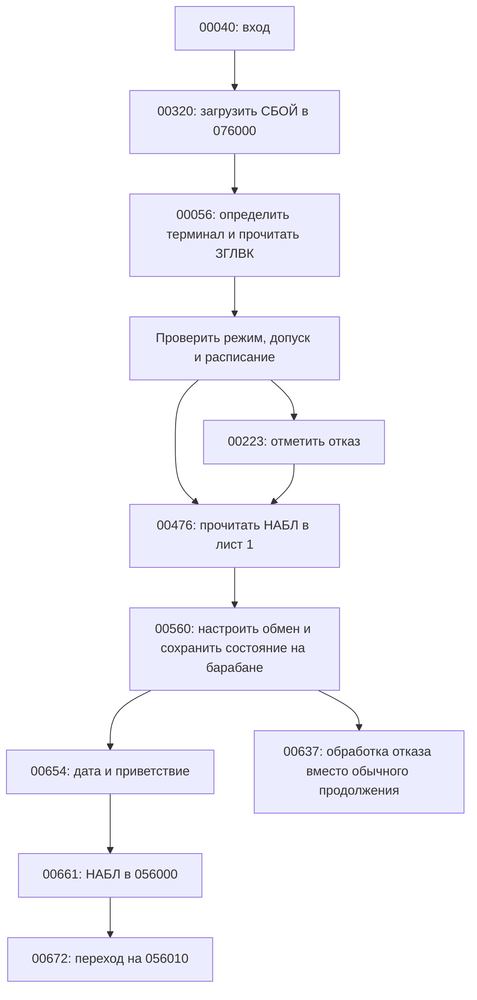

# ПУСК: вход в ПУЛЬТ и дешифратор приказов второго уровня

ПУСК занимает одну зону **01040**, загружается в **00000–01777** и
начинает работу по **00040**. Исходные 48-битные слова на томах 2148 и
2248 совпадают. SHA-256 шестибайтного образа:
`c45c0b6a689812fca1aa38d27a5f6cb0712474179e2a68ad5bdde263dc9b8501`.
В 2068 он перенесён в зону 040 без изменений.

ПУСК выполняет две разные задачи: первоначальную сборку рабочего состояния
ПУЛЬТ и обработку части приказов после запуска. Основной цикл чтения
терминала находится в НАБЛ на 056000; резидентные услуги — в СБОЙ на
076000. Когда наложение затёрло лист 0, НАБЛ сначала перечитывает ПУСК,
а затем вызывает нужный вход 010–015. Повторное чтение ПУСК не означает
повторную первоначальную загрузку.

Все адреса, номера устройств, зон и значения без специальных оговорок
ниже восьмеричные. Время, календарные даты, размеры в словах и номера
уровней приказов — десятичные. `L/R` обозначают левую/правую полуслова.

## Листинг и его границы

```sh
make pusk
```

Создаёт без запуска эмулятора:

- `build/ПУСК.lst` — символический листинг;
- `build/ПУСК.dump` — полный вывод `besmtool dump`, включая заголовок,
  данные, шаблоны команд и ещё не разобранные фрагменты.

Разметка хранится в [syms/ПУСК.sym](../syms/ПУСК.sym). Она задаёт входы,
имена рабочих ячеек, текст, таблицу приказов и границы данных. Поэтому
листинг не зависит от того, какие ветви попали в последнюю трассу.
Дизассемблер — `~/git/leobru/dispak-tools/disbesm6`.

Числовой тип **257** в sym-файле — десятичная сумма `W_DATA | W_NOEXEC`
данного дизассемблера. Он запрещает продолжать анализ исполнения через
данные и неустановленные фрагменты. Это не изменение образа и не признак
того, что соответствующие биты не могут представлять машинные команды.
Тип **520** — `W_SETBASE | 010`: для относительных ссылок обработчиков
задана база М10 = 056000. Перед концом образа эта подсказка снимается,
чтобы дизассемблер не добавлял фиктивный нулевой лист НАБЛ к листингу.

Дизассемблер при загрузке с нулевого адреса пропускает слово 0 и пишет
`СТАРТ '1'`. Число 6144 в строке `Code` означает байты; фактически это 1024 слова.
Реальный вход — 040. Слово 0 не потеряно в исходном образе:
в полном dump оно равно `7727070700000000`, декодируется как
`выпр 70707(М17); зп 0` и относится к заголовку образа, а не к обычному входу.

Имена в sym-файле аналитические. Неустановленные фрагменты не объявлены
процедурами текущего ПУСК только по внешнему сходству с командами.

## Входы и рабочие области

| Адрес | Действие |
|---|---|
| 00002 | Переход на 01606: проверка сохранённого состояния для входа в отладчик |
| 00006 | `пб (М3)`; также место установки короткого загрузочного шаблона |
| 00010 | `пб 01036`: обработчик NEW |
| 00011 | `пб 01073`: имя архива уже находится в A; поиск через список архивов |
| 00012 | `пб 01042`: СВЯЗЬ |
| 00013 | `пб 00705`: КОНЕЦ |
| 00014 | `пб 01453`: дешифратор II |
| 00015 | `уиа 01141(М12); пб 01074`: АРХ |
| 00040 | `уиа 00056(М13); пб 00320`: первоначальный запуск |

| Ячейка/диапазон | Назначение |
|---|---|
| 00037 | Маска допуска, задаваемая пускачом; в `pult2068.b6` — 0400 |
| 00041 | Шифр/подпись для печати; также задаётся пускачом |
| 00042–00045 | Дескрипторы по умолчанию: барабан 27:035, ПУСК 40:040, Pascal 40:0100, архив 40:0240 |
| 00046 | Номер терминала после `Э71` и `нед` |
| 00047–00052 | Четыре управляющих слова терминального обмена |
| 00053 | Чтение листа 27 с барабана 27:037: `0010270000270037` |
| 00055 | Флаг альтернативного запуска |
| 00154 | Слово расписания |
| 00157 | Флаги/режим из ЗГЛВК:3775 |
| 00173 | Флаг отказа в запуске, устанавливается в 00223 |
| 00375–00402 | Маски, текущий байт и чётность для приказа ПК |
| 00415–00444 | Буфер приказа ПК; этим затёрты неиспользуемые в данном пути старые слова |
| 00557 | Параметр построения терминальных дескрипторов; используется и другими процедурами |
| 00673–00703 | Изменяемый текст приветствия/завершения |
| 00716–00717 | Сформированная дата |
| 00737, 00755 | Время решения и его текстовое представление |
| 01221–01233 | Параметры подключения архива и дескриптор обмена |
| 01462 | Имя текущего приказа для дешифратора II |
| 01613–01614 | Допущенные шифр и номер терминала для административного входа |
| 01777 | Сохранённый ответ Э71 о терминале |

## Первоначальная загрузка



### СБОЙ, терминал и ЗГЛВК

**00320–00325.** Если 00157 не нуль либо устройство 40 несёт том 2048,
выполняется `Э50 0112` с A = `0400020`. Затем **00324** читает
`0010370000400035`, то есть СБОЙ из 40:035 в лист 37, и возвращается через
М13 на 00056. Значение 0400020 — аргумент задания смещения; его перевод
в физическую зону зависит от геометрии диска, не является универсальным
смещением в зонах для всех режимов dispak.

**00056–00062.** `Э71` с all-ones словом 00156 запрашивает терминал.
Ответ сохраняется в 00001 и 01777; `нед` превращает его в номер терминала
в 00046. `Э70 00275` читает ЗГЛВК из 40:036 в **02000–03777**.

В проверенном сеансе ответ Э71 — `0004000000000000`, номер терминала —
**012**, ЗГЛВК:3775 = **7**, ЗГЛВК:3776 = **0**. Поэтому этот запуск проходит
через **00070**, получает расписание all-ones и идёт на 00257;
ветви обычного ограничения доступа в данном сеансе не выполняются.

### Допуск и расписание

**00063–00071.** Слово 03775 сохраняется в 00157. При ненулевом режиме
и ненулевом 03776 слова 03776–03777 заменяют константы 01614–01613,
затем проверяется расписание. При нулевом 03776 расписание становится
all-ones, и выполнение переходит к печати шифра.

**00075–00113.** Путь с нулевым 00157 проверяет наличие тома **2068**
на устройстве 40 либо 57 через `Э50 0105`. Номера сравниваются в BCD:
константа 00170 = `020150`. Если ни одно устройство не подходит,
выполняется завершение 01610. Затем проверяются шифр и слово из
таблицы **02400 + номер терминала** в ЗГЛВК:

- если младший бит слова установлен, управление идёт на 00207;
- иначе проверяется `(слово >> 1) & M[00037]`; нуль ведёт к отказу 00223,
  ненулевой результат — к проверке расписания 00231.

**00207–00222.** Из шифра Э50 0100 выделяется старшая часть сдвигом на
32 бита. Выделены отдельные значения **0x330, 0x7245, 0x7246**;
для остальных проверяются границы **0x345 и 0x400** с сохранением/восстановлением
РЖ. Результат переводит выполнение к расписанию либо отказу.
Константа **0x4199** отдельно проверяется в 00104 и 00260.
Это сравнения машинных представлений шифра; их нельзя читать как
обычные десятичные номера пользователей.

**00231–00255.** Берётся слово **02500 + номер терминала** и время
с начала суток (`Э53 010`). Вещественные константы 00203–00205 равны
десятичным 3000, 60 и 30: время в тиках переводится в минуты/часы и выбирается
получасовой интервал. Далее переменный сдвиг слова расписания и маска 1
определяют допуск. Ветка выполняет арифметику с переключением РЖ;
динамические проверки границ получаса не проводились.

**00223–00224.** Отказ не заканчивает задачу сразу: в 00173 записывается
1, после чего всё равно загружается и настраивается НАБЛ. Только в 00611
флаг переводит исполнение на 00637. Там выводится предупреждение,
меняется текст ввода НАБЛ, запрещаются обычные пути продолжения и
управление передаётся БАВТ. Это объясняет, почему чтения НАБЛ могут быть
видны и при отказе в доступе.

### Настройка НАБЛ и барабана

**00476–00504.** К дескриптору ПУСК 40:040 прибавляется 00514 =
`0000010000000001`: получается чтение **40:041 → лист 1**.
После чтения стек с М17 = 03774 помещает в хвост НАБЛ четыре исходных
дескриптора: 03774 = архив Pascal, 03775 = ПУСК,
03776 = каталог архива, 03777 = СБОЙ с барабана.
Лист 1 сохраняется в **барабан 27:037**.

**00543–00552.** По номеру терминала строятся управляющие слова
00047–00052: чтение/вывод терминала и варианты с признаком чтения.
Это переиспользуемая процедура с возвратом через М11.

**00560–00607.** НАБЛ перечитывается в лист 1, затем:

- 00047–00052 переносятся в терминальные слова СБОЙ **076401–076404**;
- ответ о наличии терминала сохраняется в **076413**;
- в НАБЛ заполняются 03760–03765, 03600, 03773;
- копии управляющих слов получают также адреса 02401–02404, 02413;
- **00606** сохраняет обновлённый НАБЛ на 27:037;
- **00607** сохраняет лист 37 СБОЙ на **27:031**.

В **00571** задаётся число перехватываемых исключений (`Э50 0102`, A=010).
На обычном пути после приветствия **00670** назначает обработчик ошибок
на 076000 (`Э50 0103`), **00671** настраивает Э72 с ключом `KEYE72`.
В **00661** НАБЛ читается в **056000**, а **00672** передаёт ему управление
по **056010**. Сам основной цикл располагается уже вне ПУСК.

Если установлен флаг 00055, вместо этого путь **00624–00627** сохраняет
00040 в 076014, читает **40:047 → лист 2** и передаёт управление на
**04040**. Это вход пакетного исполнителя АВТПАК: он устанавливает
выборку приказов из подготовленной цепочки. Код по 04040 проверен
отдельным запуском через временный вход ПАКЕТ; сам начальный путь
ПУСК с флагом 00055 не проверялся. См. [разбор АВТПАК](avtpak.md).

## Приветствие, дата и завершение

**00654–00672** формируют приветствие. **00705–00715**, вызываемые через
вход 013 по `КОНЕЦ`, получают дату и время решения, печатают их через
НАБЛ и заканчивают задачу `Э62 0`.

**00720–00732** вызывают `Э50 0114`, выбирают биты даты маской 00733,
расставляют их операцией `рзб` и добавляют точки из 00735. Дата занимает
два слова 00716–00717, затем переносится в текст 00676–00677.
Константа **00736 = `0200001703607417` содержит цифру `8`** десятилетия.
Поэтому при системной дате 17.10.2026 в проверке напечатано **17.10.86**.
Эту строку нельзя принимать за дату сборки ПУСК.

**00740–00751** получают время через `Э63 4`, делят на вещественную
константу **50 (десятичное)** из 00753 и вызывают **00756–00775**.
Последняя процедура формирует пять десятичных цифр, используя делители
**10000, 1000, 100, 10, 1** (десятичные) из 01004–01010. Результат 00755
подставляется в сообщение `ВРЕМЯ РЕШ: ... СЕК`.

## Дешифратор II и таблица приказов

Вход **01453** получает готовое имя из **056222** НАБЛ, сохраняет его
в 01462 и сканирует пары с 01463. Имя — шесть GOST-байтов, с левым
заполнением 0377, если оно короче шести букв.

```text
01454  М1 := 01463
01455  A := M[М1] XOR M[01462]
01456  если A = 0: перейти на М1+1
01457  A := M[М1] XOR M[01537]
01460  М1 := М1+2; если A != 0: повторить с 01455
01461  перейти на 01416
```

Слово **01537 = 0377** — ограничитель. При совпадении имени исполняется
**само следующее слово таблицы**, содержащее `пб обработчик`, а не
извлекается числовой указатель на процедуру. Так выполняется второй
уровень распознавания. При промахе **01416–01417** читают БАВТ
из **40:051 → лист 33** и переходят на **066007**; это третий уровень.

| Слово имени | Имя | Обработчик | Действие |
|---|---|---|---|
| 01463 | ДИАЛОГ | 01362 | Перенос ПУСК и загрузка ЭХОЛОТ/ДЖИП |
| 01465 | ПК | 00331 | Передача текста с перекодировкой байтов и чётностью |
| 01467 | RESIST | 01540 | Административное изменение ЗГЛВК |
| 01471 | ПЗ | 01424 | Э70 со специальным управляющим словом, затем 064010 |
| 01473 | ПЕЧ | 01427 | Э62 076, затем «ЕСТЬ» |
| 01475 | ТУР | 01431 | Двухшаговый загрузочный шаблон в 6–7 |
| 01477 | КАНАЛ | 01540 | Синоним RESIST |
| 01501 | NEW | 01036 | Э62 043, затем «ЕСТЬ» |
| 01503 | СВЯЗЬ | 01042 | Терминальный обмен с временными дескрипторами |
| 01505 | Я | 01440 | Чтение и печать ЗГЛВК |
| 01507 | ИНК | 01244 | Э62 044 с A=01000000, затем «ЕСТЬ» |
| 01511 | ДИЛОС | 01324 | Подготовка дескриптора и вход в резидент 077400 |
| 01513 | DILOS | 01324 | Синоним ДИЛОС |
| 01515 | ДЖИН | 01337 | АДСИС в лист 36, ДЖИП в лист 0 |
| 01517 | ВЫД | 01247 | Э62 042, затем «ЕСТЬ» |
| 01521 | NF | 01345 | Э66 01000–01003, далее общий файловый путь |
| 01523 | OF | 01343 | М6=0, переход на 6 |
| 01525 | CL | 01355 | Загрузка файлового монитора, вход 066007 |
| 01527 | PUT | 01347 | Э66 01002–01003, далее общий файловый путь |
| 01531 | GET | 01351 | Общий файловый путь с подготовкой регистров |
| 01533 | DEL | 01353 | Файловый монитор, вход 066006 |
| 01535 | INF | 01357 | Файловый монитор, вход 066011 |

`АРХ` и `КОНЕЦ` отсутствуют в этой таблице: НАБЛ вызывает входы 015 и
013 напрямую. Равным образом СИС, АЛГ, СПИС, РЕД и часть других команд
обслуживаются другими уровнями.

### Малые обработчики и общий ответ

**01037–01040** передают М15=01041 в печать **076005**, затем уходят через
**076002**. Текст 01041 — `ЕСТЬ` с управляющими байтами.
Это общий выход для NEW, ПЕЧ, ИНК, ВЫД.

**01440–01446**, `Я`, получают подпись через указатель НАБЛ:056406,
подставляют её в 02005 после чтения ЗГЛВК в лист 1 и печатают с Э64 01451.
Поэтому текст может отсутствовать в терминальном stdout, оставаясь
в потоке печати Э64.

**01324–01335**, ДИЛОС, разбирают до двух числовых полей через 056264,
собирают дескриптор в 01336, записывают его через указатель 076020 и
переходят на 077400. Без параметров исходное слово 01336 =
`0010000000400140`; дальнейшие преобразования выполняет резидент.
В этом обработчике не следует путать исходную зону 0140 с зоной,
которую затем прочитает изменённая резидентом схема.

### Шаблоны загрузки и слова двойного назначения

**01337–01342**, ДЖИН: читается АДСИС (`01352 = 0010360000400006`),
в ячейку **6** через Э75 помещается слово из **01344**, затем выполняется
`пб 6`. Шаблон — `Э70 01351`: он читает ДЖИП по дескриптору
**01351 = `0010000000400070`** в лист 0, затирая сам ПУСК. Возврат уже
зависит от загруженного образа, а не от следующей команды старого ПУСК.

При **GET** слова **01351–01352 исполняются как код**:

```text
01351  сч 0;    уи 70
01352  сч 3600; уи 6
01353  Э70 01361
01354  пб 66006
```

Таким образом, одно и то же слово является корректным дескриптором Э70
для ДЖИН и парой инструкций для другого приказа. В листинге сохранено
декодирование команд и отмечено использование как данных. Это намеренное
наложение представлений; разметить 01351–01352 только как данные было бы
неполным разбором.

Общий файловый дескриптор **01361 = `0010330000401461`** загружает
40:01461 в лист 33. При старом смещении 01000 это физическая зона 02461,
которая не принадлежит рассматриваемому архиву ПУЛЬТ. Присутствие приказов
в таблице не доказывает наличие подходящего файлового монитора на томе.

**01431–01437**, ТУР: в 6 и 7 ставятся соответственно `Э70 01436` и
`Э70 01437`. Первый обмен читает **51:0365 → лист 1**, второй —
**51:0364 → лист 0**. Размещение шаблона в 6–7 позволяет пережить
замену листа 0. В стандартном задании устройство 51 не подключено.

## Приказ ПК и побайтовая обработка

**00331–00353** печатают приглашение, затем **00333–00334** очищают
0421–0444 и через НАБЛ:056415 принимают строку в область с 0445.
М1 указывает на исходный текст, М2 — на выходной буфер с 0415.

**00354–00361** извлекают очередной GOST-байт маской из 00375,
сдвигают маску на восемь бит и переходят к следующему исходному слову,
когда маска исчерпана. **00343–00344** распознают байт 0377 как конец.

**00362–00373** подсчитывают единицы командой `чед`, проверяют младший
бит результата через РМР и при чётном количестве единиц устанавливают
старший бит байта константой **00402 = `4000000000000000`**.
В итоге число единиц в передаваемом байте становится нечётным.
Операция `рзб 00376` и OR перепаковывают байт в выходной буфер;
после исчерпания выходной маски увеличивается М2.

Если выходной буфер непуст, **00347** вызывает `Э71 00374`
и начинает следующий приём. Если пуст — печатает `КОНЕЦ ПК` и
возвращается в НАБЛ:056010. Новый сеанс проверил именно этот пустой
выход; передача содержательной посылки и работа внешнего получателя
этим опытом не подтверждены.

## Подключение архива

Главный вход — **015**, с продолжением в М12=01141. Разбор имени
выполняет **056700** НАБЛ. Пустое имя возвращает в НАБЛ:056077;
само `АРХ` без аргумента не печатает список.

### Числовое размещение: `АРХ NAME,U,Z[,N]`

1. **01076** сохраняет имя в 01221. Если после него запятая,
   **01171–01172** устанавливают исходное устройство 032 и разбирают
   числа процедурой **01122–01127**: 01227=устройство,
   01230=зона, 01231=размер. Поля, которых нет, сохраняют текущие/исходные
   значения; запятые определяют продолжение разбора.
2. **01173** проверяет конец или допустимый разделитель.
3. **01174–01176** собирают чтение листа 1 из `(U << 12) | Z`
   с флагом чтения `0010010000000000`.
4. **01177–01200** сравнивают **02000**, первое слово прочитанного каталога,
   с запрошенным именем. Несовпадение ведёт к «НЕТ» через 01170.
5. **01134–01140** заносят имя в **057770**, размер в **057771**,
   собирают дескриптор чтения в лист 0 и уходят через М12 в **01141**.
6. **01141–01160** сохраняют этот дескриптор в **057776**, читают каталог
   теперь в лист 3, проверяют/обновляют защиту, затем записывают лист 3
   в **барабан 27:036**.
7. **01161–01166** сохраняют изменённый НАБЛ в **27:037**,
   печатают «ЕСТЬ» и возвращаются в **056010**.

Последующее чтение файла через резидент 076006 использует именно эти
настройки и барабанную копию каталога. Это не поиск исполнимого имени
в основном каталоге СИСБИБ: сначала пользователь выбирает архив.

### Именованное размещение: `АРХ NAME`

Если чисел нет, **01102** читает список описаний архивов через
**076012** в лист 1. В исходном 2248 это **КТЛБИБ, 40:037**.
ПУСК временно перенастраивает указатели разбора НАБЛ так, чтобы он читал
текст из этого листа, а не с терминала. Цикл **01113–01133** разбирает
имя и три числа каждой записи, ищет запрошенное имя и ограничитель
`КОНЕЦ`. Совпадение в **01130–01131** передаёт управление на 01134,
дальше выполняется общий путь подключения.

Подтверждено трассой: `АРХ СИСБИБ` извлекает из КТЛБИБ тройку
**40,0,100**, а затем выполняет тот же путь 01134 → 01141, что и
`АРХ СИСБИБ,40,0`. Вход **011** отличается тем, что имя приходит в A,
а не разбирается из текущей строки.
В исходном СБОЙ тома 2148 слово 076012 содержит `0010010000402667`,
тогда как на 2248 — `0010010000400037`. Поэтому одинаковый ПУСК может
читать разные списки архивов: размещение задаёт резидентный дескриптор,
а не константа внутри этой процедуры.

### Защита каталога

**01201–01214** разбирают необязательные поля после разделителя `-`:
защиту в 01223 и пароль в 01224. Признак защищённого каталога — слово
**01240 = `3763525327642560`** в **07375** листа каталога.

Если признак есть, **01155–01157** проверяют
`M[01223] XOR M[07532] XOR M[01240] == 0`. При неуспехе в 057770
записывается нуль и печатается «НЕТ».
При заданном новом пароле он XOR-ится с признаком и записывается в 07532;
слово `НЕТ` в поле пароля снимает признак. При изменении защиты каталог
записывается обратно на выбранное устройство (**01152–01153**), затем
обновляются барабанные копии. Поэтому АРХ с такими параметрами уже
не является только читающей операцией. Эта ветвь разобрана статически;
парольные изменения динамически не проверялись.

## СВЯЗЬ и административный вход

**01042–01065**, СВЯЗЬ: НАБЛ:056245 разбирает разделитель.
Ветвь с `(` вызывает **01011–01027** для вычисления параметра терминала.
Случай `)` использует 00543 и обновляет управляющие слова.
Обычный путь формирует строку вида `00:` в **057640**, назначает временные
буферы через М1/М2, вызывает Э71 с дескрипторами НАБЛ **056401–056402**,
затем восстанавливает их из **057761–057762** и возвращается в 056010.
В проверке без аргументов напечатано `00:`; полноценная связь между двумя
терминалами не проверялась.

**01540–01605**, RESIST/КАНАЛ, — административная запись в ЗГЛВК.
Перед доступом последовательно проверяются:

- шифр задачи (`Э50 0100`) против 01613;
- номер терминала против 017 либо 01614;
- нулевой канал **076014**;
- классы разобранных аргументов по маске 01616 и значениям 01617/01620,
  а также отсутствие лишнего аргумента.

После проверок загружается ЗГЛВК, и ключевое слово выбирает таблицу:

| Ключ | Адрес изменяемого слова в листе ЗГЛВК | Действие |
|---|---|---|
| РАСПИС | 02500 + номер | Записать переданное слово расписания |
| ПУСКАЧ | 02400 + номер | Записать параметр, сдвинутый влево на бит; при текущем значении 1 — выйти без записи |
| ЯЧЕЙКА | 02330 + номер | Записать переданное слово |

В **01604** изменённый лист записывается на **40:036**, затем управление
уходит через 076002. Непрошедшая проверка ведёт на 01610, завершение задачи.
Это не обычная команда выбора терминального канала и не безусловный
произвольный доступ к памяти. Работающая ветвь административной записи
динамически не проверялась.

## ДИАЛОГ и перенесённое исполнение

**01362–01366** копируют слова **00000–01776** в **010000–011776**
через Э75. Счётчик М3 стартует с 076001; переносится 1023 слова,
а не весь последний нулевой хвост 01777. М7=010000, поэтому дальнейший
`пб 01367(М7)` выполняется по **011367**.

Теперь **011370** берёт сохранённый дескриптор из копии ПУСК:010513
и цикл читает **40:064–067 → листы 0–3**. После него добавление 01411
меняет лист на 12: чтение **40:070 → лист 12**.
Это ЭХОЛОТ плюс ДЖИП, а не загрузка одноимённого файла ДИАЛОГ из каталога.

Из копии ПУСК берутся номер терминала и шаблоны, в загруженный образ
ставятся данные и команды 00376–00377. Управление идёт на **00372** уже
загруженного образа. Поэтому исходные слова ПУСК с такими же адресами
не объясняют поведение после этой точки. Работа этого приказа целиком
динамически не проверялась.

## Вход в отладчик и неустановленные фрагменты

Вектор **00002 → 01606** проверяет сохранённое слово 00001 маской
00165. При ненулевом результате исполняется **00114–00142**.
Этот код строит Э71-слова из номера терминала, выводит тексты
`ПАРОЛЬ К ОТЛ`/`УБЕРИ ОТЛАДЧ`, восстанавливает часть регистров и
переходит в **066000**; в процедуре есть Э75 и обмен с барабаном.
Обычная загрузка через 040 не заходит в эту ветвь. Фактический протокол
возврата монитора и отладчика здесь не воспроизводился.

Следующие части оставлены в символическом листинге как исходные слова,
с доступным декодированием в полном dump:

- **00016–00036** — команды/шаблоны до основного входа; связи с обычным
  запуском 040 и векторами 010–015 не установлены;
- **00416–00474** — фрагменты с внешними адресами и другим использованием
  рабочих ячеек; часть этого места превращается в буфер приказа ПК;
- **01251–01267** — загрузочный фрагмент, которому не найдено имени в
  текущей таблице; код декодирован, но назначение вызова не подтверждено;
- **01270–01323** — обработка тройки значений с текстами `ПР`, `КТ`, `КС`;
  разбирает числа через НАБЛ, хранит их в 057755–057757 и сохраняет НАБЛ
  на 27:037. Текущий пользовательский вход не установлен;
- **01627–01664** — фрагмент переноса листов/барабанов через Э70 и Э67
  с таблицей дескрипторов; нет подтверждённого входа из основного пути;
- **01665–01776** — остаточный код с адресами другого контекста. Участок
  01665–01677 буквально совпадает с теми же смещениями НАБЛ, а
  01754–01767 — с теми же смещениями СБОЙ. Совпадения сами по себе
  не доказывают, какая сборка была источником копирования.

Здесь намеренно различаются «видны команды», «найден вход» и
«путь выполнен». Не все старые слова зоны являются действующими
процедурами ПУСК этой версии.

## Проверка

Новые прогоны выполнены dispak вне песочницы, последовательно, на частных
копиях 2148/2248/2068 с отдельным HOME и `--725`. Исходные тома не менялись.
ПУСК на 2068 побитно совпадает с исходным 2248, но каталоги и выбранные
другие модули соответствуют реконструированному тому.

| Сеанс | Подтверждённое поведение |
|---|---|
| `КОНЕЦ` | Сборка рабочего состояния, вход в НАБЛ, дата/время завершения |
| `АРХ СИСБИБ,40,0`, затем АРХ без имени и КТЛ | Числовое подключение, «ЕСТЬ», вывод записей каталога; пустой АРХ возвращается без списка |
| `АРХ СИСБИБ`, `КОНЕЦ` | Поиск размещения в КТЛБИБ, подключение и нормальное завершение |
| `СВЯЗЬ`, `Я`, `ПЕЧ`, `ВЫД`, `ИНК`, `КОНЕЦ` | Входы второго уровня, `00:`, вызов Э64, три ответа «ЕСТЬ», завершение |
| `ПК`, пустая посылка, `КОНЕЦ` | Приглашение ПК, «КОНЕЦ ПК», возврат и завершение; передача непустых данных не проверялась |
| `XYZ`, `КОНЕЦ` | Промах дешифратора II, загрузка БАВТ, архивная диагностика, возврат |

Во всех сеансах код завершения dispak — 0. В сеансе с КТЛ вывод
остановлен его вопросом `ИДТИ?`; это не проверка полного каталога или
исполнения КОНЕЦ после постраничного вывода. Остальные указанные сеансы
доходят до сообщения времени решения. Файлы ввода, stdout и полные
трассы находятся в `build/pusk-probes/`.

Из пяти первых сеансов извлечены 226 различных исполненных адресов ПУСК
через `tools/phasetrace.py`; ни один не попадает в запрещённые разметкой
области данных. Сеанс именованного подключения дополнительно подтвердил
цикл поиска 01113–01133; вместе все шесть сеансов дали 243 исполненных
адреса ПУСК, также вне областей данных. Это проверка границ листинга и основных путей,
а не покрытие всех режимов ПУСК.

Исходный образ сверён с новой выгрузкой зоны 01040 через besmtool;
байты, адреса входов, таблица приказов и константы проверены статически.
